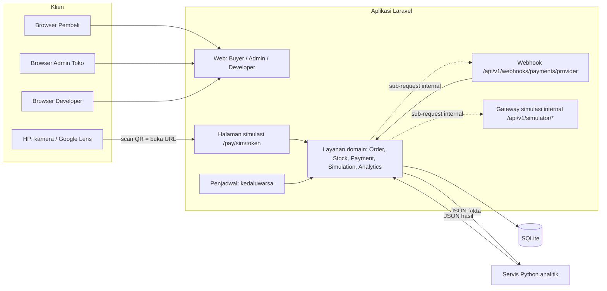
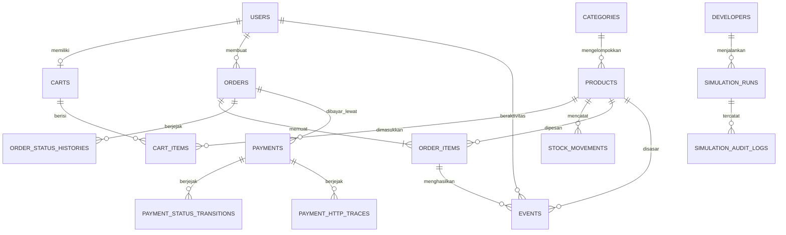
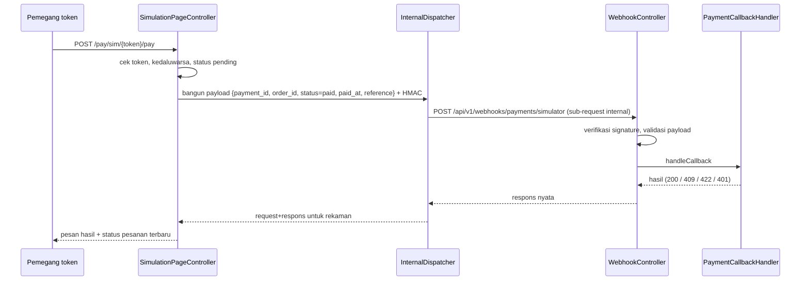

# Blueprint — Ira Stationery: E-commerce dengan Pendekatan Simulator

| Atribut | Isi |
| --- | --- |
| Versi / status | 0.1 — **DRAF untuk dikoreksi** |
| Tanggal | 1 November 2026 |
| Penyusun | Claude |
| Dokumen induk | `PRD.md` (fitur, kriteria terima, kontradiksi **K-nn**, keputusan usulan **U-nn**). Blueprint ini tidak mengulang PRD; ia menjelaskan **cara membangunnya**. ID fitur (`ACC-01`, `PAY-25`, …) merujuk ke PRD §10. |
| Aturan rujukan | `AGENTS.md` untuk keputusan fondasi (rekayasa, keamanan, verifikasi); `DESIGN.md` untuk keputusan desain. |
| Peringatan | Semua yang bertanda **(usulan)** atau **B-nn** belum diputuskan pemilik proyek. Yang dibangun adalah **simulator** payment gateway; tidak ada gateway riil yang terhubung. |
| Perubahan pemilik proyek 2026-11-02 | **Basis data diganti menjadi SQLite** (lihat A-03). Naskah asli Claude memakai PostgreSQL sebagai usulan (U-01); file proyek ini sudah diubah ke SQLite, dan PRD bagian U-01 sudah diselaraskan pada 2026-11-02 di file proyek ini (SQLite dan WITA). Konsekuensi SQLite yang sudah diterapkan pada file ini: indeks parsial dan `CHECK` tetap dipakai; konversi zona waktu WITA dilakukan di lapisan aplikasi, bukan dengan `AT TIME ZONE`; penguncian bukan per baris melainkan per berkas basis data (disarankan mode WAL), sehingga idiom `FOR UPDATE` / `FOR UPDATE SKIP LOCKED` pada §7 sudah diganti dengan transaksi tulis dan update bersyarat, dan uji konkurensi penguncian baris sudah disesuaikan. |

---

## 1. Tujuan dan Batas Blueprint

Blueprint ini menetapkan arsitektur, model data, alur kritis, rancangan modul pembayaran (termasuk ruang untuk gateway riil di masa depan), engine simulator data, kontrak ke servis Python, desain antarmuka, keamanan, pengujian, dan rencana pembangunan.

Batas:

- Versi paket/framework **tidak ditulis di sini**; diverifikasi terhadap versi terpasang saat inisialisasi proyek (`AGENTS §3`: perilaku framework bersifat spesifik versi).
- Kode Python algoritma "apa adanya" (`Ira-discussion.md` §12b) dan script generator biodata **belum diterima**; keduanya hanya dirancang sebagai kontrak (§9.3 dan §11).
- Tidak ada klaim integrasi gateway riil. Bagian 8.9 hanya menjelaskan *ruang* penambahannya.

## 2. Keputusan Arsitektur

| No | Keputusan | Status | Alasan singkat |
| --- | --- | --- | --- |
| A-01 | Aplikasi utama: **Laravel (PHP)**, monolit modular (satu basis kode, satu basis data). | Diputuskan (`D§12b`) | Stack ditetapkan pemilik proyek. |
| A-02 | Kalkulasi analitik: **servis Python terpisah**; Laravel mengirim data, Python menghitung dan mengembalikan hasil. | Diputuskan (`D§12b`); pembagian rinci = U-19 | numpy/pandas/scikit-learn dipakai apa adanya, tidak di-refactor ke PHP. |
| A-03 | Basis data: **SQLite** (berkas tunggal). | **Diputuskan pemilik proyek 2026-11-02, menggantikan usulan PostgreSQL (U-01)** | Alasan: simpel, tanpa server basis data, cukup untuk tugas/simulator. Indeks parsial dan constraint `CHECK` tetap bisa dipakai di SQLite. Konversi zona waktu WITA dilakukan di lapisan aplikasi (`PeriodResolver`), bukan `AT TIME ZONE` di SQL. Penguncian bukan per baris: SQLite mengunci berkas basis data saat tulis (disarankan mode WAL); karena itu idiom `FOR UPDATE` / `SKIP LOCKED` pada §7 sudah diganti dengan transaksi tulis dan update bersyarat. |
| A-04 | Antarmuka: **server-rendered Blade + Tailwind CSS + Alpine.js**; grafik Chart.js dibundel (tanpa CDN). | Usulan (U-01) | Muatan klien minimum (`AGENTS §5`); satu mekanisme gaya. `DESIGN` Appendix H (React/shadcn) hanya default bila stack tidak ditentukan. |
| A-05 | Autentikasi memakai mekanisme bawaan framework: dua guard terpisah — `web` (tabel `users`, peran `pembeli` dan `admin_toko`) dan `developer` (tabel `developers`). | Usulan | Developer tidak boleh dicampur (`D§3`, ACC-04); tidak menulis autentikasi sendiri (`AGENTS §9`). |
| A-06 | Pembayaran lewat **adapter** (`PaymentAdapter`), driver dipilih `PAYMENT_DRIVER`; saat ini hanya `simulator`. | Diminta eksplisit (`P§7`) | Gateway riil kelak = adapter baru + konfigurasi. |
| A-07 | Callback simulasi diproses lewat **sub-request internal** ke endpoint webhook berversi sendiri. | Usulan (U-18) | Request/response yang ditampilkan adalah kejadian nyata, bukan karangan (`P§4.2`). Risiko teknis: B-01. |
| A-08 | Seluruh perubahan status pembayaran dan pesanan melewati **satu layanan domain** per agregat. | Usulan | Satu pintu untuk callback, job, pembatalan, dan generator developer (K-05). |
| A-09 | Analitik dihitung **saat dibaca** dari tabel transaksi/event yang sama (tanpa tabel ringkasan/salinan). | Usulan | "Pembaruan cepat" dan "sumber data tunggal" (`D§5`, `D§6.4`). Cache hanya boleh ditambah bila kunci cache dan invalidasinya tertulis di blueprint ini. |
| A-10 | Penjadwal Laravel menjalankan job kedaluwarsa tiap menit; kedaluwarsa juga diperiksa saat diakses (PAY-35). | Usulan | Kebenaran tidak bergantung pada jeda penjadwal. |
| A-11 | Waktu disimpan UTC; pelaporan dan bucket dalam WITA (`REPORTING_TIMEZONE`). | Usulan (U-20) | Pengguna dan data di Indonesia; hindari kesalahan batas hari. |

## 3. Arsitektur Komponen



Tiga sisi pada diagram dijaga terpisah di kode dan di data:

| Sisi | Titik masuk | Guard | Penanda data |
| --- | --- | --- | --- |
| Sistem Asli | `/`, `/admin/*` | `web` | `origin=normal` |
| Payment Gateway Simulator | `/pay/sim/*`, `/api/v1/webhooks/*`, `/api/v1/simulator/*` | token / signature / internal | `payments.is_simulated=true` |
| Panel Developer | `/developer/*` | `developer` | `origin=developer_simulation` + `simulation_run_id` |

## 4. Struktur Proyek (usulan)

Mengikuti struktur standar Laravel; kode domain ditempatkan di `app/Services` dan `app/Payments` agar tidak tersebar di controller.

```
app/
  Http/
    Controllers/
      Auth/                 # ACC-01..04, 06
      Buyer/                # Katalog, Keranjang, Checkout, Pesanan, Pembayaran
      Admin/                # Kategori, Produk, Pesanan, Pembayaran, Akun, Analitik
      Developer/            # Panel simulator
      Payment/              # SimulationPage, Webhook, SimulatorGateway
    Middleware/             # EnsureRole, EnsureActiveAccount, InternalDispatchOnly, VerifyWebhookSignature
    Requests/               # Form Request per aksi (validasi server)
  Models/
  Services/
    Orders/                 # CheckoutService, OrderStateMachine, OrderCancellationService
    Stock/                  # StockService
    Events/                 # ActivityRecorder
    Simulation/             # Engine: lihat §9
    Analytics/              # FactsQuery, AnalyticsClient (HTTP ke Python)
  Payments/
    Contracts/              # PaymentAdapter, SignatureVerifier, QrPayload
    Simulator/              # SimulatorPaymentAdapter, SimulatorSignatureVerifier, InternalDispatcher
    Registry/               # ProviderRegistry, PaymentMethodCatalog
    Support/                # QrRenderer, VaNumberGenerator, TokenGenerator, TraceRecorder
config/
  payment.php               # PAYMENT_DRIVER, katalog metode, kedaluwarsa
  simulation.php            # Batas dan nilai default simulator
  analytics.php             # URL/kunci servis Python, timeout, zona waktu
database/migrations/        # Migrasi terurut
database/seeders/           # Dataset contoh (SIM-42), akun Admin/Developer via perintah artisan
resources/views/            # Blade: buyer/, admin/, developer/, payment/, components/, errors/
resources/css/              # Token (variabel CSS) + tema Tailwind
resources/js/               # Alpine, Chart.js (bundel), countdown, salin
routes/                     # web.php, admin.php, developer.php, payments.php, api.php
analytics-service/          # Servis Python (struktur: §11.1)
tests/                      # Unit, Feature, Browser (BB), Contract (Laravel↔Python)
```

Aturan struktur (`AGENTS §5`, `§6`): tidak ada kode alur yang menyebut kelas simulator secara langsung (PAY-55); satu mekanisme untuk routing, formulir, konfigurasi, log; berkas hasil generate dan dependensi tidak diedit tangan.

## 5. Konfigurasi dan Environment

Hanya **nama** variabel dan nilai contoh non-rahasia yang ditulis. Berkas `.env.example` berisi placeholder; rahasia diisi lokal dan tidak pernah di-commit (PAY-60, NFR-05).

| Variabel | Contoh / default | Keterangan |
| --- | --- | --- |
| `APP_URL` | `http://<alamat-yang-dapat-dijangkau-HP>:8000` | Dipakai menyusun URL pada QR (PAY-06). Bila `localhost`, instruksi pembayaran menampilkan peringatan (PAY-14). Untuk demo dari HP gunakan IP LAN atau terowongan yang sah. |
| `APP_TIMEZONE` | `UTC` | Penyimpanan UTC. |
| `REPORTING_TIMEZONE` | `Asia/Makassar` | Bucket dan tampilan WITA. |
| `DB_*` | — | Koneksi SQLite (berkas tunggal, mis. `database/database.sqlite`; mode WAL disarankan). |
| `SESSION_SECURE_COOKIE` | `false` lokal, `true` bila HTTPS | NFR-03. |
| `PAYMENT_DRIVER` | `simulator` | Nilai tak dikenal → gagal start (PAY-57). |
| `PAYMENT_EXPIRY_MINUTES` | `30` | 1–1.440 (PAY-04, U-09). |
| `PAYMENT_SIMULATOR_WEBHOOK_SECRET` | *(kosong; diisi lokal)* | Kunci HMAC signature **dummy**; tidak pernah ditampilkan. |
| `PAYMENT_SIMULATOR_CALLBACK_TRANSPORT` | `internal` | `internal` (sub-request) atau `http` (loopback; butuh server multi-pekerja). |
| `PAYMENT_STATUS_POLL_SECONDS` | `3` | PAY-13. |
| `VIEW_EVENT_DEDUP_MINUTES` | `30` | EVT-02 (U-17). |
| `SIM_ACCOUNT_EMAIL_DOMAIN` | `sim.ira-stationery.test` | TLD `.test` tercadang; ditolak pada register publik (ACC-01). |
| `SIM_ACCOUNT_PASSWORD` | *(kosong; diisi lokal)* | Kata sandi bersama akun simulasi, disimpan hash per akun (SIM-08). |
| `SIM_MAX_TRANSACTIONS_PER_REQUEST` | `500` | SIM-17 (U-03). |
| `SIM_MAX_EVENTS_PER_REQUEST` | `2000` | SIM-31 (U-03). |
| `SIM_MAX_PERIOD_DAYS` | `366` | SIM-28 (U-03). |
| *(konstanta kode)* `SIM_MAX_ACCOUNTS_PER_REQUEST` | `100` | Keputusan final (`D§1` butir 6); bukan variabel environment; tidak dapat dinaikkan lewat konfigurasi. |
| `ANALYTICS_SERVICE_URL` | `http://127.0.0.1:8001` | Servis Python internal (tidak dipublikasikan). |
| `ANALYTICS_SERVICE_KEY` | *(kosong; diisi lokal)* | Kunci internal Laravel↔Python. |
| `ANALYTICS_TIMEOUT_SECONDS` | `10` | ANL-06. |

Validasi konfigurasi dijalankan saat start (fail fast, `AGENTS §10`): driver dikenal, durasi dalam rentang, batas simulator bilangan bulat positif, `SIM_MAX_ACCOUNTS_PER_REQUEST` tidak lebih dari 100.

## 6. Model Data

Konvensi: uang = bilangan bulat rupiah (tanpa desimal); waktu disimpan UTC sebagai teks ISO-8601 (SQLite tidak punya tipe `timestamptz`); nilai enumerasi disimpan sebagai string dengan constraint `CHECK`; tabel jejak/event bersifat append-only (aplikasi tidak melakukan `UPDATE`/`DELETE` kecuali layanan reset SIM-38/39). Setiap perubahan skema lewat migrasi terurut (NFR-09).

### 6.1 Diagram relasi



### 6.2 Tabel

| Tabel | Kolom penting | Constraint dan indeks | Fitur |
| --- | --- | --- | --- |
| `users` | `id`, `role` (`pembeli`/`admin_toko`), `name`, `email`, `password` (hash), `is_active`, `deactivated_at`, `deactivation_reason`, `origin`, `simulation_run_id` (null), timestamps | unik `lower(email)`; `CHECK role`, `CHECK origin`; indeks `(role, origin)` | ACC-01..15, SIM-07 |
| `developers` | `id`, `name`, `email`, `password` (hash), timestamps | unik `lower(email)`; tabel dan guard terpisah dari `users` | ACC-04, ACC-05 |
| `categories` | `id`, `name`, `slug`, timestamps | unik `lower(name)`, unik `slug` | CAT-01..04 |
| `products` | `id`, `category_id`, `name`, `description`, `price_idr`, `stock_on_hand`, `stock_reserved`, `is_active`, timestamps | FK `category_id` `RESTRICT`; unik `lower(name)`; `CHECK price_idr BETWEEN 1 AND 100000000`; `CHECK stock_on_hand >= 0`; `CHECK stock_reserved >= 0`; `CHECK stock_reserved <= stock_on_hand`; indeks `(category_id, is_active)` | PRD-01..06, STK-01 |
| `stock_movements` | `id`, `product_id`, `type` (`penyesuaian`/`cadangkan`/`konfirmasi`/`lepas`), `delta_on_hand`, `delta_reserved`, `order_id` (null), `actor_type`, `actor_id`, `note`, `origin`, `simulation_run_id`, `created_at` | append-only; indeks `(product_id, created_at)` | PRD-07, STK-05 |
| `carts` / `cart_items` | `carts(user_id)`; `cart_items(cart_id, product_id, quantity)` | unik `carts.user_id`; unik `(cart_id, product_id)`; `CHECK quantity BETWEEN 1 AND 99` | CRT-01..06 |
| `orders` | `id`, `order_number`, `user_id`, `status`, `total_idr`, `payment_deadline_at`, `checkout_key`, `origin`, `simulation_run_id`, `created_at`, `updated_at` | unik `order_number`; unik `(user_id, checkout_key)`; `CHECK status IN (...)` (§9.2 PRD); indeks `(status, payment_deadline_at)`, `(user_id, created_at)`, `(origin, created_at)` | ORD-01..14 |
| `order_items` | `id`, `order_id`, `product_id`, `product_name_snapshot`, `unit_price_idr`, `quantity`, `subtotal_idr`, `origin`, `simulation_run_id` | FK `product_id` `RESTRICT`; `CHECK quantity BETWEEN 1 AND 99`; indeks `(product_id)`, `(order_id)` | ORD-04, EVT-07 |
| `order_status_histories` | `id`, `order_id`, `from_status`, `to_status`, `trigger`, `actor_type`, `actor_id`, `reason`, `occurred_at`, `origin`, `simulation_run_id` | append-only; indeks `(order_id, occurred_at)` | ORD-14 |
| `payments` | `id` (ULID = `payment_id`), `order_id`, `user_id`, `provider` (`simulator`), `provider_payment_id` (null; cadangan untuk provider riil), `payment_method`, `amount_idr`, `currency` (`IDR`), `status`, `reference_code`, `payment_token`, `qr_url`, `expires_at`, `paid_at`, `is_simulated`, `origin`, `simulation_run_id`, timestamps | unik `payment_token`; unik `reference_code`; **indeks parsial unik** `(order_id) WHERE status='pending'` (PAY-63); **indeks parsial unik** `(order_id) WHERE status='paid'`; `CHECK is_simulated = true` pada tahap ini; `CHECK payment_method IN (...)`; indeks `(status, paid_at)`, `(user_id, created_at)` | PAY-03, PAY-62, PAY-63 |
| `payment_status_transitions` | `id`, `payment_id`, `from_status`, `to_status`, `trigger`, `request_id`, `occurred_at`, `origin`, `simulation_run_id` | append-only; indeks `(payment_id, occurred_at)` | PAY-39, PAY-43 |
| `payment_http_traces` | `id`, `payment_id`, `request_id`, `kind` (`create_payment`/`callback`/`rejected_attempt`), `method`, `path`, `request_headers` (JSON, sudah disanitasi), `request_body` (JSON), `response_status`, `response_body` (JSON), `order_status_after`, `occurred_at`, `origin`, `simulation_run_id` | append-only; indeks `(payment_id, occurred_at)` | PAY-37, PAY-38, PAY-43, PAY-44 |
| `events` | `id`, `event_type` (`view`/`add_to_cart`/`booking`/`purchase`/`cancel`), `user_id`, `product_id`, `session_ref` (null), `order_id` (null), `order_item_id` (null), `reason` (null), `occurred_at`, `origin`, `simulation_run_id`, `created_at` | indeks `(event_type, occurred_at)`, `(product_id, occurred_at)`, `(user_id, product_id, occurred_at)`; **unik parsial** `(order_item_id, event_type) WHERE event_type IN ('booking','purchase','cancel')` (idempotensi EVT-05) | EVT-01..06 |
| `simulation_runs` | `id` (ULID), `developer_id`, `action` (`create_accounts`/`tx_user_first`/`tx_period_first`/`funnel_events`), `params` (JSON), `seed`, `period_start`, `period_end`, `status` (`running`/`berhasil`/`gagal`/`direset`), `counts` (JSON), `error_message`, `idempotency_key`, `started_at`, `finished_at`, `reset_at` | unik `(developer_id, idempotency_key)` | SIM-26, SIM-35 |
| `simulation_audit_logs` | `id`, `developer_id`, `action`, `run_id` (null), `summary` (JSON: jumlah, periode), `outcome`, `occurred_at` | append-only; tidak tersentuh reset; hak `UPDATE/DELETE` dicabut dari peran basis data aplikasi bila memungkinkan | SIM-36 |

Tabel framework (sesi, antrean/job, cache, migrasi) memakai bawaan Laravel. Keputusan `origin` pada baris turunan (item, event, histori, jejak) menyalin nilai dari agregat induknya saat ditulis agar reset dan filter analitik tidak butuh join.

### 6.3 Aturan integritas data

| Aturan | Cara menjamin |
| --- | --- |
| Stok tak pernah negatif atau terjual ganda | `CHECK` + update bersyarat/transaksi tulis (§7.2). |
| Satu pembayaran `pending` dan maksimal satu `paid` per pesanan | Dua indeks parsial unik. |
| Penjualan = pesanan dengan pembayaran `paid` | Tidak ada kolom salinan `paid`; analitik join ke `payments` (A-09, ANL-07). |
| Event `booking`/`purchase`/`cancel` tidak ganda | Indeks unik parsial pada `(order_item_id, event_type)`. |
| Data simulasi dapat dipisahkan (EVT-09) | `origin` + `simulation_run_id` pada semua tabel yang relevan; `CHECK` bahwa `simulation_run_id` terisi bila `origin='developer_simulation'`. |
| Harga lama tidak berubah | `order_items.unit_price_idr` adalah snapshot. |

## 7. Alur Kritis dan Penguncian

Aturan umum: setiap alur di bawah berjalan dalam **satu transaksi basis data**; urutan akses selalu `orders` → `payments` → `products` (berurutan `id`) untuk konsistensi. **Pada SQLite, penguncian per baris (`FOR UPDATE` / `SKIP LOCKED`) tidak berlaku:** ganti dengan transaksi tulis (mis. `BEGIN IMMEDIATE`) dan update bersyarat, dengan mode WAL. Urutan akses yang sama tetap dipertahankan, tetapi uji deadlock per baris pada naskah asli harus disesuaikan. Layanan domain dipanggil dari controller, job, atau generator; tidak ada logika di controller.

### 7.1 Checkout (ORD-02, STK-02, PAY-03)

```
transaksi:
  1. Cek kunci idempotensi (user_id, checkout_key); bila ada → kembalikan pesanan yang sama.
  2. Muat item keranjang milik sesi; kosong → gagal.
  3. Muat produk dalam transaksi tulis (urut id) untuk update bersyarat.
  4. Validasi tiap item: produk aktif, qty 1..99, (stok_fisik - stok_dicadangkan) >= qty. Gagal satu → rollback.
  5. stok_dicadangkan += qty; tulis stock_movements(cadangkan).
  6. Buat orders(status=menunggu_pembayaran, payment_deadline_at=now+PAYMENT_EXPIRY_MINUTES, order_number acak unik).
  7. Buat order_items (snapshot nama, harga); total = jumlah subtotal (dihitung di server).
  8. Tulis event booking per item; tulis order_status_histories(null → menunggu_pembayaran, trigger=pembeli).
  9. Kosongkan item keranjang.
 10. PaymentService::create(order, method)  → adapter->createPayment (lihat §8.4).
sukses → redirect ke halaman instruksi pembayaran.
```

### 7.2 Pencadangan stok tanpa oversell (STK-06)

Dua lapis: transaksi tulis SQLite, dan pembaruan bersyarat `UPDATE products SET stock_reserved = stock_reserved + :q WHERE id = :id AND stock_on_hand - stock_reserved >= :q`; bila baris terpengaruh = 0 → gagal (mutasi tanpa baris terpengaruh adalah kegagalan, NFR-01).

### 7.3 Callback `paid` (PAY-27, PAY-29, STK-03, EVT-05)

```
WebhookController → VerifyWebhookSignature (PAY-25) → validasi payload (PAY-26) → PaymentCallbackHandler:
transaksi:
  kunci pesanan lalu pembayaran lewat transaksi tulis (urutan akses tetap)
  jika payment.status final:
       status sama  → 200 {"result":"already_processed"}, tulis jejak, tanpa efek ganda
       status beda  → 409, tulis jejak, tanpa perubahan
  jika pembayaran kedaluwarsa menurut jam server (now >= expires_at) → proses sebagai expired (PAY-35), tolak paid
  PaymentStateMachine: pending → paid (set paid_at)
  OrderStateMachine: menunggu_pembayaran → dibayar
  StockService::confirm(order)  (stok_dicadangkan -= q, stok_fisik -= q; stock_movements(konfirmasi))
  event purchase per item (unik parsial menjamin sekali)
  tulis payment_status_transitions, order_status_histories, payment_http_traces
```

### 7.4 Kedaluwarsa (PAY-32, PAY-34, PAY-35)

Job `ExpireOverdueOrders` (tiap menit) memilih pesanan `menunggu_pembayaran` dengan `payment_deadline_at <= now()` dalam batch terbatas (mis. 200) — tanpa `SKIP LOCKED` (SQLite tidak mendukungnya; klaim batch harus lewat update status atomik agar tidak diproses ganda) — lalu per pesanan: bila ada pembayaran `pending`, kirim callback `expired` lewat jalur webhook (pemicu `job_kedaluwarsa`); bila tidak ada pembayaran `pending` (kasus setelah `failed`), panggil `OrderStateMachine` langsung ke `kedaluwarsa`. Keduanya melepas stok (STK-04) dan menulis event `cancel` (alasan `expired`). Pemeriksaan serupa dijalankan di awal `SimulationPageController`, halaman instruksi, dan aksi bayar/gagal (kedaluwarsa saat diakses).

### 7.5 Pembatalan oleh pembeli (ORD-07, PAY-33)

Kunci pesanan; hanya `menunggu_pembayaran` milik sendiri; `adapter->cancelPayment(payment_id)` (pembayaran `pending` → `cancelled`, tanpa lalu lintas HTTP; tercatat sebagai transisi dengan pemicu `pembeli_batal`); pesanan → `dibatalkan`; stok dilepas; event `cancel` (alasan `buyer`).

### 7.6 Pembayaran ulang setelah gagal (PAY-31)

Syarat: pesanan `menunggu_pembayaran`, `now < payment_deadline_at`, tidak ada pembayaran `pending`. Buat pembayaran baru (token dan referensi baru) dengan `expires_at = payment_deadline_at`. Indeks parsial unik menolak pembuatan kedua yang serentak.

### 7.7 Ubah status pemenuhan oleh admin (ORD-12)

Kunci pesanan; tabel transisi hanya mengizinkan `dibayar → diproses` dan `diproses → selesai`; riwayat ditulis dengan pelaku admin. Tidak ada jalur untuk menyentuh `payments` dari controller admin (PAY-53).

## 8. Modul Payment Gateway Simulator

Semua yang tampil kepada pengguna berlabel **SIMULASI** (PAY-54). Modul ini hanya mensimulasikan; tidak ada koneksi ke QRIS, Dana, GoPay, BRI, BCA, atau BNI (PAY-61).

### 8.1 Interface adapter (PAY-55)

Seluruh checkout, pesanan, dan analitik hanya bergantung pada kontrak ini (diikat ke driver aktif lewat container layanan berdasarkan `PAYMENT_DRIVER`):

```php
interface PaymentAdapter
{
    // Membuat instruksi bayar (QR/VA/token) dan waktu kedaluwarsa untuk satu pembayaran.
    public function createPayment(Order $order, string $method, Payment $payment): PaymentInstruction;

    // Status terbaru dari sisi provider (simulator: dari basis data sendiri).
    public function getPaymentStatus(string $paymentId): PaymentStatus;

    // Memvalidasi dan menerapkan callback; mengembalikan hasil terstruktur (diproses / sudah diproses / ditolak).
    public function handleCallback(array $payload, ?string $signature, string $rawBody): CallbackResult;

    // Membatalkan pembayaran yang masih pending.
    public function cancelPayment(string $paymentId): void;
}

final class PaymentInstruction
{
    public function __construct(
        public string $paymentId,
        public string $referenceCode,       // nomor VA atau kode referensi QR
        public ?QrPayload $qr,              // jenis + nilai (lihat 8.3)
        public ?string $vaNumber,
        public ?string $paymentToken,       // hanya simulator
        public \DateTimeImmutable $expiresAt,
    ) {}
}
```

Layanan `PaymentService` (dipakai checkout dan pembayaran ulang) memanggil adapter, lalu menyimpan hasilnya; perubahan **status** selalu lewat `PaymentStateMachine` (PAY-28), bukan oleh adapter secara langsung. Adapter juga tidak menyentuh stok atau event; itu tanggung jawab `PaymentCallbackHandler` (§7.3), sehingga adapter riil nanti tidak perlu mengetahui aturan stok dan analitik.

### 8.2 Katalog metode berbasis konfigurasi (PAY-01, PAY-02)

`config/payment.php` menjadi satu-satunya tempat mendefinisikan metode:

```php
'methods' => [
  'qris'    => ['label' => 'QRIS (Simulasi)',    'type' => 'qr', 'enabled' => true, 'icon' => 'qr-code'],
  'dana'    => ['label' => 'Dana (Simulasi)',    'type' => 'qr', 'enabled' => true, 'icon' => 'wallet'],
  'gopay'   => ['label' => 'GoPay (Simulasi)',   'type' => 'qr', 'enabled' => true, 'icon' => 'wallet'],
  'va_bri'  => ['label' => 'VA BRI (Simulasi)',  'type' => 'va', 'bank_code' => '01', 'enabled' => true, 'icon' => 'landmark'],
  'va_bca'  => ['label' => 'VA BCA (Simulasi)',  'type' => 'va', 'bank_code' => '02', 'enabled' => true, 'icon' => 'landmark'],
  'va_bni'  => ['label' => 'VA BNI (Simulasi)',  'type' => 'va', 'bank_code' => '03', 'enabled' => true, 'icon' => 'landmark'],
],
```

`PaymentMethodCatalog` membaca konfigurasi ini; pilihan checkout, validasi server, dan kolom `CHECK payment_method` diturunkan dari katalog yang sama (migrasi mengacu ke daftar kode saat dibuat; menambah metode baru = menambah entri + migrasi daftar kode). Ikon bersifat generik; **tidak ada logo atau warna merek** (PAY-61).

### 8.3 Token, URL, QR, VA, dan referensi

| Elemen | Rancangan | Fitur |
| --- | --- | --- |
| `payment_token` | 32 byte dari CSPRNG, base64url (±43 karakter), unik; dibangkitkan ulang bila tabrakan. Tidak diturunkan dari data pesanan. Disimpan apa adanya karena harus dapat ditampilkan ulang pada QR; hanya berguna untuk satu pembayaran dan berakhir bersamanya. | PAY-05 |
| URL simulasi | `APP_URL` + `/pay/sim/` + token. Disimpan pada `payments.qr_url`. | PAY-06 |
| `QrPayload` | Objek `{type: 'url' \| 'raw', value: string}`. Simulator selalu `type='url'`; adapter riil kelak dapat mengembalikan `raw` dari provider. Halaman instruksi hanya memanggil `QrRenderer::render(QrPayload)`. | PAY-58 |
| `QrRenderer` | Menghasilkan **SVG** inline (tanpa CDN), koreksi kesalahan M, kuiet-zone standar, ukuran tampil ≥ 240 px, dengan pita "SIMULASI" di luar area QR sehingga QR tetap terpindai. Library QR pure-PHP (U-13); versi diverifikasi saat instalasi. | PAY-07, PAY-09 |
| Nomor VA | `999` + kode bank (2 digit) + 11 digit acak; dibangkitkan dari CSPRNG, dicek keunikan, ulangi bila tabrakan. | PAY-08 |
| Kode referensi QR | `SIMQR-` + 10 karakter dari alfabet tanpa karakter membingungkan (CSPRNG), unik. | PAY-10 |

### 8.4 Pembuatan pembayaran dan gateway simulasi internal (PAY-03, PAY-37)

`SimulatorPaymentAdapter::createPayment()` tidak memanggil jaringan. Agar request/response yang tampil di panel benar-benar terjadi, adapter mengirim request ke "gateway simulasi" milik aplikasi sendiri lewat `InternalDispatcher` (§8.5):

```
POST /api/v1/simulator/payments          (hanya dapat dicapai lewat dispatch internal)
{ "order_id": "IRA-261101-K7M2QX", "amount": 45000, "currency": "IDR",
  "payment_method": "qris", "reference": "<payment_id>",
  "callback_url": "<APP_URL>/api/v1/webhooks/payments/simulator",
  "return_url": "<APP_URL>/pesanan/IRA-261101-K7M2QX" }
→ 201 { "payment_id": "<ULID>", "payment_token": "…", "qr_url": "…", "expires_at": "…" }
   (untuk VA: "va_number" menggantikan "qr_url" dan token tetap ada untuk QR pendamping)
```

Rute `/api/v1/simulator/*` dilindungi middleware `InternalDispatchOnly` (memeriksa atribut request yang hanya dapat diset oleh dispatcher; request HTTP luar → 404). Body tidak memuat secret apa pun. Respons beserta request direkam sebagai `payment_http_traces(kind=create_payment)` (§8.7).

### 8.5 InternalDispatcher dan callback simulasi (PAY-16, PAY-17, PAY-36)

Alur tombol **Bayar Sekarang (Simulasi)**:



- `InternalDispatcher` membangun objek request sintetis, mengirimnya melalui router/kernel aplikasi (rute, middleware, dan controller yang sama dengan request nyata), lalu **memulihkan** state request luar (binding request, sesi) setelahnya. Pilihan `PAYMENT_SIMULATOR_CALLBACK_TRANSPORT=http` mengganti ini dengan loopback HTTP (butuh server multi-pekerja agar tidak menunggu dirinya sendiri).
- **Risiko B-01:** sub-request di dalam request yang sedang berjalan dapat mengganggu state global; wajib ada *spike* dan uji regresi (CSRF/sesi request luar tidak berubah, transaksi basis data tetap satu koneksi) sebelum PAY-36 dinyatakan selesai.
- Aksi **Simulasikan Gagal** memakai jalur sama dengan `status=failed`. Job kedaluwarsa memakai jalur sama dengan `status=expired` (§7.4).
- Pembayaran `cancelled` oleh pembeli tidak melalui webhook (bukan peristiwa dari provider); tercatat sebagai transisi dengan pemicu `pembeli_batal`.

### 8.6 Webhook, signature, dan idempotency (PAY-24..27)

| Aspek | Rancangan |
| --- | --- |
| Rute | `POST /api/v1/webhooks/payments/{provider}`; `provider` divalidasi terhadap `ProviderRegistry` (hanya `simulator`); tidak dikenal → 404. Dikecualikan dari CSRF, dilindungi verifikasi signature dan pembatasan laju. |
| Header | `X-Simulator-Signature: sim-hmac-sha256=<hex>`; `Content-Type: application/json`. |
| Signature | HMAC-SHA256 atas **body mentah** dengan `PAYMENT_SIMULATOR_WEBHOOK_SECRET`; dibandingkan waktu-konstan. Kunci tidak pernah ditampilkan. Antarmuka menulis: "signature ini dummy, bukan signature gateway riil". |
| Payload | `payment_id`, `order_id`, `status` ∈ {`paid`,`failed`,`expired`}, `paid_at` (wajib bila `paid`), `reference`. Cocokkan `order_id` dan `reference` dengan pembayaran; nominal tidak diterima dari payload (PAY-23). |
| Respons | 200 `{"result":"processed","payment_status":"…","order_status":"…"}`; 200 `{"result":"already_processed"}`; 401 signature salah; 404 provider/pembayaran tidak ada; 409 konflik status final; 422 payload tidak valid. |
| Idempotency | Berdasarkan `payment_id` dan status final (§7.3); callback ganda serentak diserialkan oleh transaksi tulis SQLite dan idempotency `payment_id`. |
| cURL (PAY-41) | Dibangun dari request yang sama: URL absolut, dua header di atas, body JSON; signature adalah HMAC sah untuk body itu (artinya perintah cURL benar-benar dapat dijalankan dan mengikuti aturan PAY-27). Tidak memuat secret. |

### 8.7 Perekam jejak dan panel (PAY-37..44)

`TraceRecorder` menulis `payment_http_traces` dan `payment_status_transitions` dari objek request/response **nyata** (bukan templat). Sanitasi sebelum simpan: buang header `Authorization`, `Cookie`, `Set-Cookie`, dan semua header yang namanya memuat `secret`/`key`/`token` kecuali `payment_token` yang memang bagian URL simulasi; kunci signature tidak pernah ada pada objek yang direkam. Panel membaca baris tersimpan dan menampilkannya read-only dengan encoding aman (PAY-42). Percobaan ditolak (token dipakai ulang, signature salah, kedaluwarsa) direkam sebagai `kind=rejected_attempt` agar dapat diaudit (PAY-21).

Pembayaran buatan panel developer (SIM-30) hanya memiliki `payment_status_transitions` (pemicu `panel_developer`) dan tidak memiliki baris trace HTTP; panel menampilkan catatan "Dibuat oleh panel developer — tanpa lalu lintas HTTP" (K-05).

### 8.8 Halaman instruksi, hitung mundur, dan status (PAY-11..14, PAY-35)

- Server mengirim `expires_at` (ISO-8601 UTC) dan `server_now`; klien menghitung selisih jam untuk hitung mundur. Pada nol, klien meminta status; **server** yang menentukan (kedaluwarsa saat diakses, PAY-35).
- `GET /pembayaran/{payment}/status` (pemilik saja) mengembalikan `{status, order_status, redirect_url?}`; klien memeriksa tiap `PAYMENT_STATUS_POLL_SECONDS` hanya saat tab terlihat dan berhenti pada status final lalu mengalihkan ke halaman hasil.
- Halaman simulasi `/pay/sim/{token}` memakai logika hitung mundur yang sama.
- Peringatan `APP_URL` loopback (PAY-14) dihitung di server saat merender.

### 8.9 Ruang untuk gateway riil di masa depan (persiapan, bukan integrasi)

Tidak ada gateway riil yang dibangun atau diklaim terhubung. Susunan berikut hanya memastikan penambahannya kelak tidak mengubah checkout, pesanan, dan analitik (`P§7`).

| Titik ekstensi | Hari ini | Saat provider riil ditambahkan |
| --- | --- | --- |
| Adapter | `SimulatorPaymentAdapter` | Kelas baru yang mengimplementasikan `PaymentAdapter` (memanggil API provider) |
| Pemilihan driver | `PAYMENT_DRIVER=simulator` | Nilai baru terdaftar pada `ProviderRegistry` |
| Katalog metode | 6 metode `type: qr/va` | Entri/atribut baru di `config/payment.php` (mis. provider per metode) |
| Webhook | `/api/v1/webhooks/payments/simulator` | `/api/v1/webhooks/payments/{provider-baru}` + `SignatureVerifier` baru pada registri |
| Signature | HMAC dummy | Verifikator sesuai dokumen provider; kunci dari environment/secret manager |
| QR | `QrPayload(type=url)` | `QrPayload(type=raw)` dari provider |
| ID provider | tidak dipakai | `payments.provider_payment_id` (kolom sudah tersedia) |
| Kredensial | `PAYMENT_SIMULATOR_WEBHOOK_SECRET` | Variabel environment provider; tidak pernah di kode, UI, atau jejak |
| Rute simulasi | Aktif | Nonaktif bila driver ≠ `simulator` (PAY-57) |

Yang **tidak** berubah: `CheckoutService`, `OrderStateMachine`, `PaymentStateMachine`, `PaymentCallbackHandler` (aturan stok/event), skema pesanan/event, dan seluruh analitik. Yang **tidak boleh** dilakukan sebelum ada persetujuan perubahan scope: menambah provider riil, logo/branding pihak bank atau e-wallet, atau klaim bahwa pembayaran diproses oleh mereka (`D§9`, `P§10`).

## 9. Engine Simulator Data (Panel Developer)

Engine dipakai hanya oleh guard `developer` (ACC-10) dan hanya menulis baris `origin=developer_simulation` (SIM-40). Ia memakai layanan domain yang sama dengan Sistem Asli (state machine, pencatat event) agar aturan tidak ganda (SIM-14).

### 9.1 Komponen

| Komponen | Tugas | Fitur |
| --- | --- | --- |
| `SimulationRequestValidator` | Validasi batas (akun ≤ 100, transaksi ≤ batas, periode), cakupan user, produk aktif | SIM-03, 17, 19, 28 |
| `SeededRandom` | PRNG berbenih (§9.2) | SIM-05, SIM-20..24 |
| `BiodataGenerator` (kontrak) | Pembuat biodata akun (§9.3) | SIM-04..06 |
| `PeriodResolver` | Mengubah tanggal WITA menjadi rentang UTC `[mulai 00:00, akhir 23:59:59.999]` | SIM-10, SIM-16, SIM-29 |
| `TimeDistributor`, `UserDistributor`, `ProductPicker`, `StatusAssigner` | Distribusi (§9.4) | SIM-20..23, SIM-34 |
| `FunnelPlanner` | Merencanakan rantai event dan event yatim (§9.5) | SIM-12, SIM-24, SIM-29 |
| `SimulationPlan` | Objek rencana tak-ubah (dipakai pratinjau dan eksekusi) | SIM-25..27 |
| `SimulationExecutor` | Menulis rencana dalam satu transaksi, lewat layanan domain | SIM-13, 27, 30 |
| `SimulationResetService` | Reset per run / seluruhnya | SIM-38, 39 |
| `SimulationAudit` | Run + audit log | SIM-35, 36 |

### 9.2 Determinisme dan benih

- Seluruh keputusan acak memakai satu `SeededRandom` berbasis algoritma sederhana yang diimplementasikan sendiri dan stabil lintas versi PHP (mis. xoshiro128** atau mulberry32 pada integer 32-bit), bukan fungsi acak bawaan yang perilakunya dapat berubah.
- **Mode deterministik:** benih dari input (default U-02: `20261101`). **Mode random:** benih dibangkitkan sistem dan **disimpan pada `simulation_runs.seed`**, sehingga run random pun dapat diulang.
- Masukan terurut: akun dan produk diurutkan berdasarkan `id` sebelum dipilih; tidak ada pemakaian `now()` pada keputusan rencana. Dengan benih, parameter, dan keadaan produk/akun yang sama, rencana identik (ID, `created_at`, dan ULID dikecualikan dari perbandingan, SIM-05).

### 9.3 Kontrak generator biodata (SIM-06, U-02b)

```php
interface BiodataGenerator
{
    /** @return list<array{name:string, email:string}>  // kolom tambahan boleh ada (mis. phone)
     *  Email wajib berdomain config('simulation.email_domain') dan unik di dalam hasil. */
    public function generate(int $count, int $offset, ?int $seed): array;
}
```

- Isi script generator **tidak ditetapkan di sini**; script dari pemilik proyek dipasang sebagai implementasi baru di balik antarmuka yang sama (bila perlu adaptor), tanpa mengubah fitur lain.
- Sampai script diterima, repositori hanya memuat *test double* untuk pengujian (nama berurutan, mis. "Simulasi 0001") dan **tidak** dirilis sebagai generator final.
- Setelah generate: `SimulationRequestValidator` memeriksa tabrakan email terhadap `users` dan di dalam hasil; tabrakan → seluruh permintaan ditolak utuh (SIM-05) atau, pada mode random, dibangkitkan ulang terbatas lalu ditolak bila tetap bertabrakan.
- Kata sandi tidak berasal dari generator; dari `SIM_ACCOUNT_PASSWORD` (SIM-08). Hash dihitung sekali per akun (biaya ±beberapa puluh ms per akun, sehingga 100 akun masih wajar dalam satu request).

### 9.4 Distribusi (SIM-20..23, SIM-34)

| Dimensi | Mode | Algoritma |
| --- | --- | --- |
| Waktu (hari) | merata | Kuantil sama rata atas jumlah detik periode. |
| Waktu | acak (default) | Sampel seragam atas detik periode (invers CDF dari PRNG berbenih). |
| Waktu | menaik / menurun (M7) | Kerapatan linear naik/turun sepanjang periode; sampel dengan invers CDF (akar kuadrat). |
| Waktu | satu titik | Semua `booking` pada tanggal+jam yang diminta; rantai funnel tetap berurutan. |
| User | merata | Round-robin atas daftar terurut (selisih ≤ 1, SIM-21). |
| User | acak (default) | Pilihan seragam berbenih. |
| User | berbobot | Bobot `1/peringkat` pada urutan acak berbenih (sebagian dominan). |
| Produk | merata/acak/berbobot | Seperti user; bobot berbobot mengikuti peringkat acak berbenih. Subset produk dibatasi pilihan Developer. |
| Status akhir | rasio | Metode sisa terbesar (largest remainder) agar jumlah per status tepat dan total = jumlah transaksi (SIM-23). |

### 9.5 Rantai funnel dan stempel waktu (SIM-24, SIM-29)

Untuk tiap pesanan: pilih waktu `booking` T, lalu tetapkan jeda berbenih (default usulan: `view→add_to_cart` 1–30 menit, `add_to_cart→booking` 1–20 menit, `booking→paid` 1–10 menit; lebih kecil dari batas bayar 30 menit). Agar seluruh rantai jatuh di dalam periode, T dipilih dari distribusi pada rentang `[mulai + jeda_sebelum, akhir − jeda_sesudah]`. Urutan terjamin `view ≤ add_to_cart ≤ booking ≤ paid_at ≤ payment_deadline_at`.

Rasio funnel (SIM-12, default 40% dan 60%) menghasilkan **event yatim**: `add_to_cart` tanpa `booking` dan `view` tanpa `add_to_cart` untuk pasangan (akun, produk) berbeda dalam periode yang sama, sehingga jumlah tiap tahap menyusut (D§8). Perhitungan per item: `carts_total = items / 0.6`, `views_total = carts_total / 0.4`.

### 9.6 Pratinjau, eksekusi, dan atomisitas (SIM-25..27)

1. Formulir → `SimulationPlan` dibangun **tanpa menulis data** → pratinjau menampilkan jumlah akun/pesanan/event/pembayaran, periode, benih, status akhir, dan pengecualian SIM-15.
2. Konfirmasi membawa `idempotency_key` dan hash parameter; hash berubah → pratinjau ulang wajib.
3. `SimulationExecutor` membuka satu transaksi basis data, menulis baris dalam potongan (±1.000 baris per `INSERT` massal) berurutan: pesanan → item → pembayaran → transisi/riwayat → event; lalu memperbarui `simulation_runs(status=berhasil, counts)`.
4. Kegagalan di mana pun → rollback total; run dicatat `gagal` (di luar transaksi yang dibatalkan) beserta pesan galat, dan audit tetap ditulis.
5. Eksekusi sinkron dalam satu request pada batas default (500 transaksi ≈ ribuan baris). **B-03:** bila benchmark menunjukkan terlalu lambat, pindahkan ke antrean dengan status run yang dipoll; kontrak pratinjau/konfirmasi tidak berubah.

### 9.7 Pembayaran backdate (SIM-30, K-05)

Untuk setiap pesanan hasil panel: `PaymentStateMachine` dan `OrderStateMachine` yang sama dipakai secara programatik dengan pemicu `panel_developer` dan stempel waktu rencana. Status akhir:

| Status akhir transaksi | Pembayaran | Pesanan (riwayat) |
| --- | --- | --- |
| `selesai` (default 80%) | `paid` (`paid_at` di periode) | `menunggu_pembayaran → dibayar → diproses → selesai` |
| `dibatalkan` (10%) | `cancelled` | `menunggu_pembayaran → dibatalkan` + event `cancel` (alasan `buyer`) |
| `kedaluwarsa` (10%) | `expired` | `menunggu_pembayaran → kedaluwarsa` + event `cancel` (alasan `expired`) |

Metode pembayaran dipilih dari katalog (PAY-01) secara berbenih. Tidak ada callback HTTP dan tidak ada trace HTTP. Stok **tidak** dikurangi (SIM-15, tidak ada baris `stock_movements`).

### 9.8 Aksi 4 — funnel eksplisit (SIM-31..33)

Validasi `view ≥ add_to_cart ≥ booking ≥ purchase ≥ 0`; `view` dan `add_to_cart` ditulis sebagai event langsung; setiap `booking` membuat pesanan nyata (jalur §9.7) dengan `purchase` = jumlah yang berstatus `paid`, sisanya `dibatalkan`/`kedaluwarsa`. Preset *minat tanpa pembelian* (SIM-32) dan *funnel lengkap* (SIM-33) hanyalah nilai awal untuk formulir ini.

### 9.9 Reset dan perlindungan data normal (SIM-38..41)

`SimulationResetService` berjalan dalam satu transaksi dengan predikat selalu `origin='developer_simulation'` (dan `simulation_run_id` untuk reset per run). Urutan hapus: `events` → `payment_http_traces` → `payment_status_transitions` → `order_status_histories` → `payments` → `order_items` → `orders` → akun. Akun dihapus hanya bila tidak memiliki baris `origin='normal'` apa pun (pesanan, event, pembayaran); jika punya, akun dinonaktifkan dan hal ini dilaporkan (U-23). Konfirmasi dengan mengetik frasa; `simulation_audit_logs` tidak disentuh; `simulation_runs.status` menjadi `direset`. Tidak ada rute atau metode yang menerima ID pesanan/akun normal (SIM-40/41).

### 9.10 Performa (NFR-08)

Batas default (500 transaksi, ≈1.000 item, ≈8.000 baris event) dikerjakan dengan `INSERT` massal berpotongan dan indeks yang ditulis di §6.2. Target uji: eksekusi di mesin pengembangan standar selesai dalam batas waktu request yang dikonfigurasi; angka sebenarnya dilaporkan dari pengukuran, bukan diasumsikan.

## 10. Pencatatan Event dan Transaksi (sumber analitik tunggal)

`ActivityRecorder` adalah satu-satunya pintu penulisan event; controller dan layanan memanggilnya, bukan menulis ke tabel `events` langsung.

| Event | Dipicu oleh | Aturan |
| --- | --- | --- |
| `view` | Controller detail produk (Pembeli aktif) | Dedup: tidak menulis bila ada `view` akun+produk yang sama dalam `VIEW_EVENT_DEDUP_MINUTES`; dicek di dalam transaksi singkat agar permintaan serentak tidak menggandakan (EVT-02). |
| `add_to_cart` | `CartService::add` setelah validasi sukses | Tidak ditulis pada gagal, ubah jumlah, hapus (EVT-03). |
| `booking` | `CheckoutService` (§7.1) | Per item, dalam transaksi yang sama (EVT-04). |
| `purchase` | `PaymentCallbackHandler` (§7.3) | Per item; indeks unik parsial menjamin sekali (EVT-05). |
| `cancel` | `OrderCancellationService` dan kedaluwarsa | Per item; `reason` `buyer`/`expired` (EVT-06). |

Konsistensi (EVT-08): dashboard, daftar pesanan, inventori, dan laporan membaca `orders`, `order_items`, `payments`, `events`, `products` yang sama. Tidak ada tabel agregat. Uji invarian (§15.3) memeriksa bahwa `Σ event purchase = Σ item pesanan terbayar` dan `Σ penjualan analitik = Σ total pesanan terbayar` untuk filter yang sama.

## 11. Analitik: Kontrak Laravel ↔ Python

Pembagian (U-19): Laravel menyusun **data fakta** dari basis data (satu sumber), Python menghitung semua FR-01..06, Laravel memvalidasi dan menampilkan hasil serta menyediakan penelusuran ke sumber (ANL-05).

> **Catatan penting:** kode Python "apa adanya" (`Ira-discussion.md` §12b) **belum dilampirkan**. Bentuk JSON di bawah adalah **usulan kontrak**. Setelah kode diterima, nama field dan ambang (U-25, U-26) disesuaikan dengan signature kode yang sebenarnya; yang dijaga adalah prinsipnya: Laravel kirim data, Python hitung, kontrak berversi, respons divalidasi.

### 11.1 Struktur servis Python (usulan)

```
analytics-service/
  app.py                 # pembungkus HTTP tipis (usulan FastAPI) — U-01
  algorithms/            # kode Python yang sudah ada, dipakai apa adanya (tidak di-refactor)
    trend.py funnel.py compare.py interest.py category.py summary.py
  schemas.py             # validasi bentuk request/response
  tests/                 # pytest, uji golden-data
  requirements.txt
```

Pembungkus HTTP hanya menerjemahkan JSON ↔ pemanggilan fungsi yang ada. Servis tidak membaca basis data dan tidak diekspos publik (alamat internal, kunci `X-Internal-Key`).

### 11.2 Endpoint dan kegunaan

| Endpoint | FR | Fitur |
| --- | --- | --- |
| `POST /v1/analyze/summary` | FR-01 | ANL-11..14 |
| `POST /v1/analyze/trend` | FR-02 | ANL-21..24 |
| `POST /v1/analyze/funnel` | FR-03 | ANL-31..35 |
| `POST /v1/analyze/compare` | FR-04 | ANL-41..46 |
| `POST /v1/analyze/interest` | FR-05 | ANL-51, ANL-53, ANL-54 |
| `POST /v1/analyze/category` | FR-06 | ANL-61..65 |
| `GET /v1/health` | — | Pemeriksaan ketersediaan (tanpa data) |

Riwayat aktivitas (ANL-52) dan penelusuran (ANL-05) adalah kueri langsung Laravel ke tabel sumber; tidak ada kalkulasi algoritma.

### 11.3 Bentuk request (usulan)

```json
{
  "schema_version": 1,
  "request_id": "01J…",
  "timezone": "Asia/Makassar",
  "period": { "start": "2026-10-01", "end": "2026-10-31" },
  "granularity": "week",
  "origin_filter": "all",
  "params": { "metric": "units", "product_ids": [12, 15], "top_n": 5 },
  "products": [{ "id": 12, "name": "Pulpen Gel 0,5 mm", "category_id": 3, "price_idr": 5000, "is_active": true }],
  "facts": [{
    "date": "2026-10-01", "product_id": 12,
    "units_sold": 4, "revenue_idr": 20000, "orders_paid": 3,
    "views": 40, "add_to_carts": 16, "bookings": 10, "purchases": 4, "cancels": 1
  }]
}
```

- `facts` berbutir **per hari WITA per produk**, hanya baris yang memiliki aktivitas atau penjualan (Python mengisi bucket kosong dengan 0 pada deret waktu). Ukuran terbatas: ≤ 366 hari × jumlah produk (dataset contoh ±40 produk ≈ ≤ 15.000 baris).
- Endpoint `compare` menerima dua blok `period`/`facts` berlabel `A` dan `B`.
- Tidak ada data pribadi: `facts` tidak memuat akun; riwayat per pelanggan tidak dikirim ke Python.

### 11.4 Bentuk respons (usulan)

```json
{
  "schema_version": 1,
  "request_id": "01J…",
  "algorithm_version": "<dari kode Python>",
  "computed_at": "2026-11-02T03:00:00Z",
  "result": { "…": "bergantung endpoint; mis. trend: [{product_id, label: naik|turun|stabil|data_belum_cukup, change_pct, series: [...]}]" },
  "warnings": []
}
```

Laravel memvalidasi kunci wajib per endpoint sebelum dipakai; bentuk tidak sesuai diperlakukan sebagai galat servis (bukan ditampilkan). `warnings` ditampilkan pada UI (mis. data belum cukup).

### 11.5 Penyusunan data fakta (`FactsQuery`) — satu sumber

Sketsa (SQLite — diubah dari PostgreSQL), parameter periode dikonversi ke rentang UTC dari tanggal WITA (`PeriodResolver`), filter asal data ditambahkan bila bukan `all`. Bucket tanggal WITA dihitung dengan penyesuaian +7 jam pada fungsi tanggal SQLite (bukan `AT TIME ZONE`), karena waktu disimpan UTC:

```sql
-- Penjualan (waktu transaksi = paid_at, ANL-07)
SELECT date(p.paid_at, '+8 hours') AS d, oi.product_id,
       SUM(oi.quantity) AS units_sold, SUM(oi.subtotal_idr) AS revenue_idr,
       COUNT(DISTINCT o.id) AS orders_paid
FROM payments p
JOIN orders o ON o.id = p.order_id
JOIN order_items oi ON oi.order_id = o.id
WHERE p.status = 'paid' AND p.paid_at >= :start_utc AND p.paid_at < :end_utc
  AND (:origin = 'all' OR o.origin = :origin)
GROUP BY 1, 2;

-- Event (jumlah per jenis; waktu = occurred_at)
SELECT date(e.occurred_at, '+8 hours') AS d, e.product_id, e.event_type, COUNT(*) AS n
FROM events e
WHERE e.occurred_at >= :start_utc AND e.occurred_at < :end_utc
  AND (:origin = 'all' OR e.origin = :origin)
GROUP BY 1, 2, 3;
```

Kedua hasil digabung per `(d, product_id)` menjadi `facts`. Penelusuran (ANL-05) memakai predikat yang sama (`WHERE` identik) untuk menampilkan baris pesanan atau event sumbernya.

### 11.6 Penanganan kegagalan dan performa (ANL-04, ANL-06, NFR-07)

| Kondisi | Perilaku |
| --- | --- |
| Servis tidak dapat dijangkau / timeout (`ANALYTICS_TIMEOUT_SECONDS`) | UI "Perhitungan sedang tidak tersedia" + tombol coba lagi; **bukan** angka nol; satu percobaan ulang otomatis untuk permintaan idempoten; sisa aplikasi (toko) tetap berjalan. |
| Respons bentuk salah / `schema_version` tidak cocok | Dianggap galat servis; dicatat dengan `request_id`; pesan generik ke pengguna. |
| Tidak ada data pada periode | Keadaan kosong (bukan galat). |
| Latensi | Tanpa cache pada tahap awal (A-09). Bila pengukuran melebihi target ANL-04, cache boleh ditambah dengan kunci `(endpoint, periode, granularitas, origin_filter, data_version)` dan invalidasi pada setiap penulisan transaksi/event; perubahan itu ditulis di blueprint ini lebih dulu. |

### 11.7 Rujukan definisi per FR (diterapkan pada kode Python)

| FR | Definisi yang harus dipatuhi hasil |
| --- | --- |
| FR-01 | Penjualan = Σ `revenue_idr`; transaksi = Σ `orders_paid` (per pesanan unik); terlaris = kuantitas menurun, seri → nilai menurun → nama; paling sedikit = kuantitas menaik **termasuk 0** untuk produk aktif, seri → nama. |
| FR-02 | Deret per bucket granularitas; klasifikasi naik/turun/stabil dengan ambang U-25 dan minimum bucket; basis nol → persen tidak ditampilkan. |
| FR-03 | Empat hitungan event; rasio = tahap/tahap sebelumnya dan tahap/`view`; pembagi nol → null; anomali ditandai, tidak disembunyikan. |
| FR-04 | Metrik A dan B, selisih absolut dan persen, basis nol → null. |
| FR-05 | Produk dilihat (distinct produk dengan `views` > 0); sorotan `views ≥ 20` dan `purchases/views ≤ 5%` (U-26). |
| FR-06 | Agregasi per kategori (`category_id`), porsi, tren, matriks kategori × dua periode, kelompok harga (ANL-64). |

## 12. Peta Rute dan Otorisasi

Semua rute terproteksi dideklarasikan pada berkas rute dengan middleware guard + peran; rute tanpa deklarasi gagal pada uji daftar rute (ACC-08). Singkatan: **P** = Pembeli (guard `web`, peran `pembeli`), **A** = Admin Toko (`web`, `admin_toko`), **D** = guard `developer`, **T** = token pembayaran, **S** = signature, **I** = dispatch internal.

| Kelompok | Rute (ringkas) | Akses | Fitur |
| --- | --- | --- | --- |
| Auth | `GET/POST /daftar`, `/masuk`; `POST /keluar` | publik / P | ACC-01, 02, 06 |
| Auth admin | `GET/POST /admin/masuk` | publik | ACC-03 |
| Auth developer | `GET/POST /developer/masuk` | publik | ACC-04 |
| Katalog | `/katalog`, `/katalog/cari`, `/produk/{produk}` | P | SHP-01..04, EVT-02 |
| Keranjang | `/keranjang` (+ tambah/ubah/hapus) | P | CRT-01..06 |
| Checkout & pesanan | `/checkout`, `POST /checkout`, `/pesanan`, `/pesanan/{nomor}`, `POST /pesanan/{nomor}/batal` | P (milik sendiri) | ORD-01..09 |
| Pembayaran pembeli | `/pembayaran`, `/pembayaran/{id}`, `/pembayaran/{id}/instruksi`, `GET /pembayaran/{id}/status`, `/pembayaran/{id}/struk`, `POST /pesanan/{nomor}/bayar-ulang` | P (milik sendiri) | PAY-11, 13, 31, 45..50 |
| Halaman simulasi | `GET /pay/sim/{token}`, `GET /pay/sim/{token}/status`, `POST /pay/sim/{token}/pay`, `POST /pay/sim/{token}/fail` | T (+ CSRF untuk POST, + rate limit) | PAY-15..23 |
| Webhook | `POST /api/v1/webhooks/payments/{provider}` | S (tanpa CSRF) | PAY-24..27 |
| Gateway simulasi | `POST /api/v1/simulator/payments` | I saja (luar → 404) | PAY-37 |
| Admin toko | `/admin/kategori`, `/admin/produk`, `/admin/produk/{id}/stok`, `/admin/produk/{id}/riwayat-stok` | A | CAT, PRD |
| Admin transaksi | `/admin/pesanan`, `/admin/pesanan/{nomor}`, `POST …/status`, `/admin/pembayaran`, `/admin/pembayaran/{id}` | A (pembayaran read-only) | ORD-10..13, PAY-51..53 |
| Admin akun | `/admin/akun-pembeli`, `…/{id}`, `POST …/{id}/status` | A | ACC-11..13 |
| Admin analitik | `/admin/analitik/{dashboard,tren,funnel,perbandingan,aktivitas,kategori}` (+ endpoint data JSON) | A | ANL-* |
| Developer | `/developer`, `/developer/akun`, `/developer/transaksi-user`, `/developer/transaksi-periode`, `/developer/funnel`, `/developer/akun-simulasi`, `/developer/jejak`, `/developer/audit`, `/developer/reset` (+ pratinjau/konfirmasi) | D | SIM-* |
| Sistem | Halaman galat 403/404/419/429/500 | — | NFR-16 |

Kebijakan respons tidak berwenang: sumber daya milik orang lain atau tidak ada → respons yang sama (404); peran salah pada rute yang jelas bukan miliknya → 403 atau 404 sesuai matriks PRD §8 (tidak membocorkan keberadaan, `AGENTS §9`).

## 13. Desain Antarmuka (mengikuti DESIGN.md)

### 13.1 Catatan Desain (format `DESIGN §13`)

```
Design Notes
- Register · archetype: Product · Storefront = E-commerce/catalog (runner-up: Education/friendly); Admin = Admin back-office + Analytics SaaS; Developer = Developer tool; Halaman simulasi = Fintech (mobile-first)
- Dials: Storefront D5·E5·M3 · Admin D6·E4·M2 · Developer D7·E3·M2 · Halaman simulasi D5·E3·M2
- Tokens: brand biru tinta (baseline Appendix C, brand-600 #2563EB) · neutral slate · Inter · radius 10 · shadow sm/md/lg · ikon Lucide
- Assumptions: tanpa gambar produk (placeholder ikon+gradien per kategori); light theme saja; tanpa logo bank/e-wallet; bahasa Indonesia, WITA
- Added screens (not in spec): 403/404/419/429/500, toast, dialog konfirmasi, keadaan kosong/galat/loading (NFR-16)
- Backend needs: paginasi, filter status/tanggal pada daftar, endpoint polling status pembayaran (§8.8)
- To restyle: "lebih hangat", "lebih padat", "mode gelap", "lebih ramai" — hanya token yang berubah (DESIGN Appendix F)
```

Penyimpangan dan penyesuaian terhadap `DESIGN.md` (dinyatakan sekali, `DESIGN §12`):

| Butir `DESIGN.md` | Penyesuaian | Alasan |
| --- | --- | --- |
| §2: tambahkan layar standar (profil, pengaturan) | **Tidak** ditambahkan profil/pengaturan; hanya layar galat, toast, dan keadaan UI | Aturan penelusuran fitur pemilik proyek lebih tinggi daripada saran `DESIGN.md` (PRD §3.3). |
| Appendix H: React + shadcn | Blade + Tailwind + Alpine | Stack Laravel sudah diputuskan; aturan stack yang ada menang (U-01). |
| §6: "emoji vs SVG" | SVG (Lucide) di seluruh UI | Sesuai aturan produk. |

### 13.2 Token (satu sumber nilai visual)

Token disimpan sebagai variabel CSS pada `resources/css/tokens.css` dan dipetakan ke tema Tailwind; komponen tidak memakai nilai mentah (`DESIGN §7`). Nilai awal mengikuti Appendix C `DESIGN.md` (pasangan teks, semantik, dan batas pada Appendix C sudah diperiksa terhadap WCAG AA oleh dokumen tersebut). **Setiap perubahan hue atau penambahan warna wajib memeriksa ulang kontras** (NFR-15).

```css
:root {
  --brand-50:#EFF6FF; --brand-100:#DBEAFE; --brand-200:#BFDBFE;
  --brand-500:#3B82F6; --brand-600:#2563EB; --brand-700:#1D4ED8; --brand-900:#1E3A8A;
  --bg:#F8FAFC; --surface:#FFFFFF; --surface-2:#F1F5F9;
  --border:#E2E8F0; --border-input:#7B8BA3;
  --text:#0F172A; --text-2:#475569; --text-3:#64748B; --focus:#2563EB;
  --success:#15803D; --success-bg:#DCFCE7; --warning:#B45309; --warning-bg:#FEF3C7;
  --error:#B91C1C; --error-bg:#FEE2E2; --info:#1D4ED8; --info-bg:#DBEAFE;
  --r-sm:6px; --r-md:10px; --r-lg:16px; --r-full:999px;
  --shadow-sm:0 1px 2px rgba(15,23,42,.06),0 1px 3px rgba(15,23,42,.08);
  --shadow-md:0 4px 12px rgba(15,23,42,.08);
  --shadow-lg:0 16px 40px rgba(15,23,42,.14);
}
```

Skala tipografi dan ukuran kontrol mengikuti Appendix C (body 16, 14 pada tabel padat; target sentuh 44 px di ponsel). Penanda **SIMULASI** memakai pasangan `--warning` pada `--warning-bg` (sudah diperiksa pada Appendix C) disertai ikon dan teks.

### 13.3 Empat permukaan, dijaga berbeda

| Permukaan | Pengguna | Karakter | Pembeda wajib |
| --- | --- | --- | --- |
| **Storefront** | Pembeli | Ramah, produk-pertama; kartu produk dengan placeholder ikon+gradien per kategori | Bilah atas dengan pencarian dan keranjang |
| **Admin Toko** | Admin | Padat, tabel dan grafik; sidebar bergrup | Tanpa penanda simulasi, kecuali badge SIMULASI pada baris data simulasi |
| **Panel Developer** | Developer | Padat, utilitarian | Bilah permanen "SIMULATOR — data eksperimental" (teks + ikon), sidebar berwarna berbeda, judul halaman berawalan "Simulator" (`D§3`: tidak boleh tertukar dengan Admin) |
| **Halaman simulasi pembayaran** | Pemegang token (sering dari HP) | **Mobile-first**, satu kolom, kontras tinggi | Label "SIMULASI PEMBAYARAN" besar di atas lipatan; panel HTTP di bawah aksi |

### 13.4 Peta layar dan resep (`DESIGN` Appendix D)

| Layar | Resep | Keadaan yang harus ada | Fitur |
| --- | --- | --- | --- |
| Masuk / Daftar (pembeli, admin, developer) | Layar terbagi: panel merek + kartu form ≤ 400 px | galat per field, loading tombol, akun nonaktif | ACC-01..04 |
| Katalog | Grid kartu + sidebar kategori + pencarian | loading (skeleton), kosong, tidak ditemukan, galat | SHP-01..04 |
| Detail produk | Gambar placeholder + info + kontrol jumlah | habis, galat tambah ke keranjang | SHP-02, CRT-01 |
| Keranjang | Tabel/kartu item + ringkasan lengket | kosong, item bermasalah | CRT-01..06 |
| Checkout + pilih metode | Ringkasan + enam kartu metode berlabel SIMULASI | belum memilih, submit ganda, stok tidak cukup | ORD-01, ORD-02, PAY-02 |
| Instruksi pembayaran | QR besar atau VA besar + hitung mundur + tombol alternatif | aktif, kedaluwarsa, peringatan `APP_URL` | PAY-07, 09, 11..14 |
| **Halaman simulasi** | Satu kolom mobile: label → ringkasan → countdown → 3 aksi → panel HTTP | pending, berhasil, gagal, kedaluwarsa, final/dipakai ulang, tidak ditemukan | PAY-15..23, 37..42 |
| Hasil berhasil / gagal / kedaluwarsa | Kartu hasil + ringkasan + aksi lanjut | tiga varian | PAY-45..47 |
| Struk simulasi | Dokumen cetak (CSS print), label tercetak | — | PAY-48 |
| Riwayat pesanan & detail | Daftar + detail dengan linimasa status | kosong | ORD-08, 09, PAY-49, 50 |
| Admin: Dashboard | Header + filter periode/asal data; 2 kartu KPI; grafik tren 2/3 + daftar terlaris/terendah 1/3 | kosong, galat servis, loading | ANL-11..15 |
| Admin: Tren, Funnel, Perbandingan, Aktivitas & Minat, Kategori | Kontrol filter di atas, grafik + tabel alternatif, tautan "Lihat sumber" | kosong, "data belum cukup", galat servis | ANL-21..24, ANL-31..35, ANL-41..46, ANL-51..55, ANL-61..65 |
| Admin: Kategori, Produk (daftar/form), Riwayat stok | Resep daftar/formulir | kosong, validasi, konfirmasi hapus | CAT, PRD |
| Admin: Pesanan, Pembayaran (+ detail & jejak) | Daftar berfilter; detail dengan linimasa dan panel HTTP read-only | kosong | ORD-10..13, PAY-51, 52 |
| Admin: Akun pembeli | Daftar + detail | kosong, dialog nonaktifkan | ACC-11..13 |
| Developer: Beranda, Buat akun, Transaksi per user, Transaksi per periode, Funnel | Formulir bersegmen → **pratinjau** → konfirmasi | pratinjau, berhasil, gagal (rollback), batas terlampaui | SIM-02..34 |
| Developer: Akun simulasi, Jejak, Audit, Reset | Daftar berfilter; reset dengan konfirmasi ketik frasa | kosong, konfirmasi | SIM-35..39 |
| Sistem | 403/404/419/429/500 dengan satu tombol kembali | — | NFR-16 |

### 13.5 Navigasi dan responsif (`DESIGN §8`)

| Permukaan | Desktop (≥1024) | Tablet (768–1023) | Ponsel (360–767) |
| --- | --- | --- | --- |
| Storefront | Bilah atas: Katalog, Keranjang, Pesanan, Pembayaran, Akun | Sama | Tab bawah (≤5) |
| Admin | Sidebar bergrup: *Analitik* (Dashboard, Tren, Funnel, Perbandingan, Aktivitas & Minat, Kategori) · *Toko* (Produk, Kategori produk) · *Transaksi* (Pesanan, Pembayaran) · *Akun* (Akun pembeli) | Rail ikon | Tab bawah 4 teratas + "Lainnya"; tabel menjadi kartu; filter ke bottom sheet |
| Developer | Sidebar 8 item | Rail ikon | Tab bawah + "Lainnya" |
| Halaman simulasi | Kolom tengah di dalam kartu | Sama | Satu kolom penuh, aksi menempel dekat bawah |

Satu sistem tata letak adaptif (flex/grid, tanpa lebar piksel tetap); target sentuh ≥ 44×44 px; layar diperiksa pada ≈390/768/1280 px (NFR-14).

### 13.6 Komponen, keadaan, dan aksesibilitas

- Komponen dipakai ulang sebagai varian: `Button(variant, size, state)`, `Input(state)`, `StatusChip`, `DataTable`, `StatCard`, `EmptyState`, `Dialog`, `Toast`, `Countdown`, `CopyButton`, `JsonPanel`, `SimBadge`, `SimBanner`.
- Keadaan tombol: default, hover, pressed, focus-visible, disabled, loading. Input: default, focus, terisi, galat, disabled. Daftar: skeleton, kosong, tidak ada hasil, galat+coba lagi, terisi.
- `StatusChip` selalu warna + ikon + label. Status pesanan dan pembayaran masing-masing memiliki tampilan untuk **setiap** nilai (§9 PRD).
- Fokus keyboard terlihat; dialog menjebak fokus dan mengembalikannya; label terkait field; galat dihubungkan ke field (`aria-describedby`); `aria-live` sopan untuk perubahan status pembayaran dan hasil salin; hitung mundur tidak diumumkan tiap detik; animasi menghormati `prefers-reduced-motion`.
- Salinan UI Indonesia; format `Rp 1.250.000`, `12 Okt 2026`, jam WITA; label tindakan spesifik dan konsisten (mis. "Bayar Sekarang (Simulasi)", "Simulasikan Gagal", "Kembali ke Pesanan", "Batalkan pesanan").

### 13.7 Spesifik pembayaran: QR, VA, SIMULASI, panel HTTP

- **QR:** SVG inline, ≥ 240 px, area kuiet putih; pita "SIMULASI — bukan QR pembayaran riil" **di luar** area modul QR; `<title>` dan teks alternatif memuat kata SIMULASI.
- **VA:** nomor besar bertipe monospasi tabular, dikelompokkan; tombol salin menyalin tanpa spasi; label "Nomor VA SIMULASI — bukan nomor rekening".
- **Ikon metode:** generik (`qr-code`, `wallet`, `landmark`); nama metode berupa teks; tanpa logo/warna merek.
- **Panel "Simulated HTTP Request & Response":** tiga tab (Pembuatan pembayaran, Callback, Timeline); blok kode `readonly` dengan tombol salin JSON dan salin cURL; catatan "signature dummy" tampak; JSON dirender sebagai teks yang di-escape; di ponsel blok kode menggulir horizontal di dalam wadahnya (halaman tidak menggulir ke samping).
- **Status final:** halaman simulasi mengganti tombol aksi dengan pesan status dan tautan; tidak ada kontrol yang menyiratkan perubahan masih mungkin.

### 13.8 Grafik

Chart.js dibundel; satu komponen pembungkus untuk semua FR (ANL-03): sumbu berlabel dan satuan, tooltip, legenda, palet dari token, keadaan kosong/galat, serta tombol "Lihat sebagai tabel" sebagai alternatif aksesibel. Funnel: batang horizontal empat tahap dengan label jumlah dan persen. Donut hanya ≤ 5 irisan.

## 14. Keamanan (pemetaan ke AGENTS.md §9)

| Kendali | Rancangan | Fitur / NFR |
| --- | --- | --- |
| Otorisasi di trusted layer | Middleware guard+peran, kebijakan per sumber daya, kueri selalu dibatasi `user_id` dari sesi; rute tanpa deklarasi gagal uji | ACC-08, ACC-09, NFR-01 |
| Autentikasi | Guard dan tabel terpisah untuk Developer; hash modern bawaan framework; pesan galat generik; ID sesi diregenerasi saat login | ACC-02..04, NFR-03 |
| Pembatasan laju | Login (tiga form), `/pay/sim/*`, webhook, aksi simulator; dijalankan sebelum hashing/pekerjaan mahal | NFR-04 |
| Sesi | HTTP-only, SameSite, Secure bila HTTPS; umur terbatas; sesi diputus saat akun dinonaktifkan (`EnsureActiveAccount` pada setiap request terotentikasi) | ACC-07 |
| CSRF | Aktif untuk semua POST ber-cookie, termasuk aksi halaman simulasi; dikecualikan **hanya** untuk webhook yang dilindungi signature | PAY-24, NFR-02 |
| XSS | Blade `{{ }}` (escape) di mana-mana; JSON jejak dirender sebagai teks; kata kunci pencarian di-escape; tidak ada `{!! !!}` pada data pengguna | PAY-42, SHP-03 |
| Injeksi SQL | Eloquent/query builder berparameter; pencarian meng-escape wildcard; tidak ada SQL dari input mentah | SHP-03 |
| Token pembayaran sebagai capability | Entropi tinggi, satu pembayaran, kedaluwarsa, tidak dapat ubah nominal, 404 generik, rate limit, upaya ditolak tercatat. **Dicatat sebagai pengecualian sadar** terhadap prinsip "otorisasi di titik aksi": `P§4.3` menetapkan token cukup (K-12, U-11); data yang tampil dibatasi (PAY-22) | PAY-05, 19..23 |
| Webhook | Signature HMAC atas body mentah, perbandingan waktu-konstan, idempotency, rute provider divalidasi registri | PAY-24..27 |
| Dispatch internal | `/api/v1/simulator/*` hanya dapat dicapai lewat dispatcher (middleware `InternalDispatchOnly`) | §8.4 |
| Rahasia | Hanya dari environment; tidak di kode, log, UI, jejak; `.env.example` placeholder | PAY-44, PAY-60, NFR-05 |
| Privasi | Halaman simulasi tanpa data pribadi; riwayat aktivitas admin tanpa kredensial; tidak ada data pribadi di URL/log | PAY-22, ANL-52 |
| Panel developer | Guard terpisah; semua tulis dibatasi `origin=developer_simulation`; audit append-only; reset dengan konfirmasi ketik frasa | ACC-10, SIM-36..41 |
| Keamanan servis Python | Hanya alamat internal; `X-Internal-Key` dari environment; tanpa data pribadi pada payload; timeout dan validasi respons | ANL-06 |
| Header | CSP restriktif (tanpa sumber skrip eksternal), `X-Content-Type-Options`, `Referrer-Policy`, `X-Frame-Options`/`frame-ancestors` | NFR-02 |

## 15. Strategi Pengujian

### 15.1 Alat (usulan, U-01)

PHPUnit/Pest untuk unit dan feature; basis data uji **SQLite, sama dengan produksi**, agar indeks parsial dan `CHECK` teruji pada mesin yang sama (uji penguncian baris pada naskah asli diganti dengan uji transaksi tulis dan update bersyarat, karena SQLite mengunci per berkas, bukan per baris); pengendali waktu (`Carbon::setTestNow`) pada semua uji yang menyentuh kedaluwarsa dan periode; pytest untuk servis Python; uji peramban (mis. Playwright atau Dusk — **B-05**) untuk alur BB; uji kontrak untuk Laravel↔Python.

### 15.2 Whitebox (Fase 3) — target unit

| Unit | Kasus kunci | Fitur |
| --- | --- | --- |
| `OrderStateMachine`, `PaymentStateMachine` | Tabel transisi penuh (sah dan tidak sah), final tak berubah | ORD-06, PAY-28 |
| `StockService` | Cadang/konfirmasi/lepas, idempotensi, tak-negatif; dua proses berebut stok terakhir | STK-01..06 |
| `PaymentCallbackHandler` | `paid` ganda, `paid` lalu `failed`, kedaluwarsa pada `now == expires_at` dan ±1 detik, payload tidak valid, signature salah | PAY-24..29, 35 |
| `TokenGenerator`, `VaNumberGenerator`, referensi QR | Format, panjang, keunikan, tabrakan, awalan `999` | PAY-05, 08, 10 |
| `PaymentMethodCatalog` | Enam metode, nonaktif, kode tidak dikenal | PAY-01, 02 |
| Kepatuhan arsitektur | Tidak ada rujukan kelas simulator di luar `app/Payments/Simulator` dan penyedia layanan | PAY-55 |
| `ActivityRecorder` | Dedup `view`, `purchase` hanya saat `paid`, `cancel` alasan | EVT-02..06 |
| `SeededRandom`, distribusi | Benih sama → urutan sama; sebaran merata; selisih ≤ 1; sisa terbesar tepat | SIM-05, 20..23 |
| `SimulationExecutor` | Rantai kronologis, rasio funnel menyusut, pembayaran konsisten, atomik (gagal tengah jalan → nol baris), tidak mengurangi stok | SIM-12, 23, 24, 27, 29, 30 |
| `SimulationResetService` | Hitungan baris `origin=normal` identik sebelum/sesudah; akun berdata normal tidak dihapus | SIM-38..41 |
| `PeriodResolver`, `FactsQuery` | Batas hari WITA (23:59 vs 00:00), filter asal data, definisi penjualan | ANL-01, 02, 07 |
| Kode Python | Uji golden-data (deret naik/turun/datar → klasifikasi; funnel; basis nol) terhadap kode "apa adanya" | ANL-22, 31..35, 43, 53, 61 |

### 15.3 Invarian lintas modul (uji properti pada data hasil simulasi)

1. `Σ event purchase` = `Σ item pesanan berpembayaran paid` (per filter periode/asal data).
2. `Σ penjualan analitik` = `Σ total pesanan berpembayaran paid` = angka pada daftar pesanan dengan filter yang sama.
3. Tidak ada pembayaran `paid` tanpa pesanan berstatus `dibayar`/`diproses`/`selesai`, dan sebaliknya.
4. Untuk setiap pesanan: `view ≤ add_to_cart ≤ booking ≤ paid_at` bila ada; jumlah event tahap tidak menambah ke tahap berikutnya pada data hasil panel.
5. `stok_fisik`, `stok_dicadangkan`, dan riwayat gerakan konsisten (`stok_dicadangkan` = Σ item pesanan `menunggu_pembayaran` normal).
6. Semua baris `origin='developer_simulation'` memiliki `simulation_run_id`; reset tidak mengubah hitungan baris `origin='normal'`.

### 15.4 Blackbox (Fase 4) — alur pengguna

Mengikuti PRD §13.2 (Alur A–E). Tambahan khusus pembayaran:

| Skenario | Hasil yang diharapkan |
| --- | --- |
| Enam metode dipilih bergantian | Masing-masing menampilkan QR atau VA+QR berlabel SIMULASI; tanpa logo |
| Pindai QR dengan kamera/Google Lens dari HP (manual, perangkat nyata) | Halaman simulasi terbuka; setelah Bayar, halaman instruksi di laptop beralih otomatis |
| Bayar dua kali / klik cepat / cURL ulang | Satu efek; kedua → "sudah diproses"; stok dan event tidak ganda |
| Token kedaluwarsa, token final, token acak | Pesan jelas / 404 generik; upaya tercatat |
| Ubah `amount` di URL atau body | Diabaikan/ditolak; nominal dari server |
| `PAYMENT_DRIVER` kosong atau tidak dikenal | Aplikasi gagal start dengan pesan jelas |
| `APP_URL=localhost` | Peringatan QR tidak dapat dibuka dari perangkat lain tampil |

### 15.5 Yang tidak dibuktikan

Uji memakai simulator dan data eksperimental; tidak membuktikan perilaku terhadap gateway riil, infrastruktur produksi, atau aplikasi bank/e-wallet (QR bukan payload resmi). Uji dengan *mock* atau *test double* (mis. generator biodata sementara) tidak membuktikan perilaku dengan script atau kode Python final. Hasil dilaporkan apa adanya (`AGENTS §11`).

## 16. Rencana Pembangunan

Mengikuti PRD §12 dan `D§6.5`. Tiap tahap selesai bila fitur lulus kriteria terima dan checklist §18.

| Tahap | Keluaran teknis utama | Fitur |
| --- | --- | --- |
| **M0 — Inisialisasi** | Proyek Laravel, SQLite, token CSS, layout, validasi konfigurasi start, CI uji, `.env.example`; **spike B-01** (sub-request internal) dan **spike B-02** (benchmark insert massal) | NFR-* |
| **M1 — Akun dan akses** | Dua guard, form masuk/daftar, RBAC, manajemen akun, provisioning artisan | ACC-01..15 |
| **M2 — Katalog** | Kategori, produk, stok, riwayat stok, katalog pembeli, seeder dataset | CAT, PRD, SHP |
| **M3a — Alur pembeli** | Keranjang, checkout atomik, state machine pesanan, stok, `ActivityRecorder`, manajemen pesanan admin | CRT, STK, ORD, EVT |
| **M3b — Pembayaran inti** | Adapter + registri + katalog metode, token/QR/VA, halaman instruksi dan simulasi, webhook + signature, idempotency, job kedaluwarsa | PAY-01..36, PAY-55..63 |
| **M3c — Jejak dan hasil** | `TraceRecorder`, panel HTTP, salin JSON/cURL, halaman hasil, struk, riwayat, tampilan admin, audit label SIMULASI | PAY-37..54 |
| **M4 — Simulator dasar** | Akun massal, Aksi 2, Aksi 3 (acak/merata), pratinjau, eksekusi atomik, Aksi 4 eksplisit, run, audit, reset | SIM-01..31, 35..42 |
| **M5 — Analitik P0** | Servis Python, `FactsQuery`, kontrak, FR-01..03, komponen lintas | ANL-01..08, ANL-11..15, ANL-21..24, ANL-31..35 |
| **M6 — Analitik P1** | FR-04, FR-05 | ANL-41..46, ANL-51..55 |
| **M7 — Analitik P2 dan penyempurnaan** | FR-06; profil tren naik/turun; preset funnel | ANL-61..65, SIM-32..34 |

## 17. Hal Terbuka, Risiko, dan Keputusan Usulan Blueprint

Keputusan usulan produk (**U-nn**) dan kontradiksi (**K-nn**) ada pada `PRD.md` §6–§7. Butir di bawah khusus teknis.

| No | Butir | Usulan sementara | Dampak bila salah |
| --- | --- | --- | --- |
| **B-01** | Sub-request internal di dalam request berjalan dapat mengganggu state global (request/sesi/transaksi) | *Spike* dan uji regresi di M0; fallback loopback HTTP (server multi-pekerja) atau layanan domain langsung dengan perekaman request/response yang dibangun dari objek nyata | PAY-36 dan jujur-tidaknya panel HTTP bergantung pada ini |
| **B-02** | Kinerja insert massal dan batas default 500 transaksi (U-03) | Benchmark di M0/M4; ukuran potongan 1.000 baris | Batas diturunkan atau eksekusi dipindah ke antrean (B-03) |
| **B-03** | Eksekusi simulator sinkron vs antrean | Sinkron pada batas default | Antrean dengan status run dipoll |
| **B-04** | Penjadwal di lingkungan lokal/demo | Dokumentasikan perintah menjalankan penjadwal; PAY-35 menjaga kebenaran tanpa penjadwal | Pesanan kedaluwarsa menumpuk sampai diakses |
| **B-05** | Alat uji peramban (Playwright vs Dusk) | Ditetapkan saat M0 | — |
| **B-06** | Kode Python "apa adanya" dan kerangka pembungkus (FastAPI usulan) | Menunggu kode dari pemilik proyek | Kontrak §11 disesuaikan |
| **B-07** | Cara menjalankan servis Python bersama aplikasi (proses terpisah vs kontainer) | Proses terpisah pada host yang sama, alamat internal | Hanya memengaruhi deployment |
| **B-08** | Akses HP ke `APP_URL` saat demo (LAN/terowongan) | Dokumentasikan; peringatan PAY-14 | QR tidak dapat dibuka dari HP |
| **B-09** | Pengelolaan `SIM_ACCOUNT_PASSWORD` dan kunci HMAC pada tim | Dari environment masing-masing, tidak di repositori | Kebocoran rahasia (dianggap bocor bila terpapar) |
| **B-10** | Versi Laravel/PHP/SQLite/Python | Diverifikasi saat M0 terhadap dokumentasi versi terpasang | API berbeda |

## 18. Checklist Penyelesaian

Diterapkan pada setiap tahap (`AGENTS §17`, `DESIGN §13`):

- [ ] Fitur memenuhi kriteria terima PRD; tidak ada perilaku di luar fitur; asumsi dicatat.
- [ ] Mengikuti pola dan struktur yang ada; diff ditinjau (tanpa debug, tanpa berkas hasil generate, tanpa rahasia).
- [ ] Skema, validator, tipe, dokumentasi, dan uji diperbarui bersama.
- [ ] Otorisasi, validasi server, dan privasi diperiksa; tidak ada rahasia di kode/log/UI/jejak.
- [ ] Galat, kasus tepi, dan keadaan loading/kosong/galat ditangani; submit ganda dicegah.
- [ ] UI diperiksa pada ≈390/768/1280 px, keyboard, dan kontras; tanpa void besar atau dinding teks; satu keluarga ikon, satu resep radius/bayangan.
- [ ] Label **SIMULASI** ada pada semua tampilan pembayaran, QR, struk, dan jejak; tidak ada logo bank/e-wallet; tidak ada klaim gateway riil.
- [ ] Verifikasi relevan dijalankan; hasil dilaporkan apa adanya, termasuk yang belum diverifikasi.
- [ ] Laporan akhir: hasil, berkas terdampak, verifikasi, keterbatasan, dan status lokal/terdorong.
