# Ira Stationery — Alur Kerja Sistem (UML)

> **Ruang lingkup:** Dokumen ini menggambarkan **keseluruhan sistem** Ira Stationery
> per 2026-11-15 — toko (admin dan pembeli) beserta analitik trennya (FR-01–FR-06).
> **Dokumen ini menggantikan versi DFD** (`Workflow + DFD`, 2026-11-08): diagram
> konteks dan diagram level 0/1 diganti dengan diagram UML — Use Case, Aktivitas,
> Sekuens, Kelas, dan Mesin Status — supaya alurnya lebih mudah dibaca. Isi
> langkah-langkahnya sama (diperbarui ke keadaan kode saat ini), hanya cara
> menggambarnya yang berubah.
> **Pasangan file ini:** `Blueprint-Workflow.md` menjelaskan layar dan keadaan tiap layar
> untuk Figma. File ini menjelaskan **perilaku sistemnya**: siapa melakukan apa,
> urutan langkahnya, objek apa yang terlibat, dan bagaimana objek-objek itu
> berhubungan.
> **Bahasa:** Indonesia. Mata uang Rupiah. Zona waktu WITA (Asia/Makassar).
> **Keputusan yang sudah masuk ke dokumen ini:** pembelian dihitung saat dibayar;
> stok berkurang permanen saat pembayaran berhasil; admin menandai `selesai`
> = barang sudah diambil (kolom `picked_up_at`); jadwal ambil wajib diisi saat
> checkout (kolom `pickup_at`); label SIMULASI sudah **dihapus** dari UI pembeli
> dan admin — asal data (normal/simulasi) hanya tersimpan sebagai metadata dan
> dipakai sebagai filter di analitik, bukan sebagai label di layar.

## Cara membaca dokumen ini

- **Diagram (Mermaid)** dirender langsung oleh GitHub di halaman file ini.
  Legenda bentuknya mengikuti UML:
  - **Diagram Use Case (§1):** persegi = aktor (orang di luar sistem),
    stadium (persegi bersudut sangat membulat) = use case (sesuatu yang bisa
    dilakukan aktor), kotak besar = batas sistem. Panah = aktor memakai use case.
    Catatan jujur: Mermaid belum punya tipe diagram use case native, jadi
    diagram §1 digambar sebagai flowchart dengan bentuk-bentuk UML — maknanya
    sama, hanya alat gambarnya yang menyesuaikan.
  - **Diagram Aktivitas (§2):** flowchart dengan titik mulai/selesai dan
    belah ketupat untuk keputusan/percabangan. Setiap diagram disertai
    langkah bernomor yang menjelaskan hal yang sama dengan kata-kata.
  - **Diagram Sekuens (§3):** garis hidup tiap peserta dari atas ke bawah;
    panah = pesan yang dikirim; balasan digambar putus-putus. Kotak `alt`
    = percabangan (bila … maka …).
  - **Diagram Kelas (§4):** kotak = kelas (nama, atribut, metode penting);
    garis = relasi (`1 -- *` dibaca "satu ke banyak").
  - **Diagram Mesin Status (§5):** lingkaran hitam = keadaan awal; panah
    berlabel = perpindahan status.
- **Angka bernomor (1. 2. 3. …)** adalah langkah yang dilakukan manusia atau
  sistem, dalam urutan.
- **Nama tabel, kolom, rute, dan nama kelas** diambil dari kode yang
  benar-benar ada di repo, bukan dari karangan. Bila sebuah nama berubah di
  kode, dokumen ini harus ikut berubah (lihat §8).

## Aktor (hanya ada tiga)

| Aktor | Masuk lewat | Intinya |
| --- | --- | --- |
| **Pembeli** | Daftar dan login (`/daftar`, `/masuk`) | Melihat katalog, mengisi keranjang, checkout, mensimulasikan pembayaran, melihat pesanannya sendiri. |
| **Admin Toko** | Login (`/masuk`, pilih aktor Admin Toko) | Mengelola kategori, produk, stok, pesanan, pembayaran, akun pembeli; membaca analitik. |
| **Developer** | Login (`/masuk`, pilih aktor Developer) | Membuka panel simulator: membuat akun dan transaksi eksperimental, melihat jejak, me-reset data simulasi saja. |

Satu pintu masuk (`/masuk`) dengan pilihan aktor; rute lama `/admin/masuk` dan
`/developer/masuk` hanya mengarahkan (302) ke `/masuk`. Satu orang tidak
merangkap peran dalam satu sesi.

---

## 1. Diagram Use Case

Diagram ini menjawab: **siapa bisa melakukan apa**. Semua use case di sini ada
halaman atau aksinya di sistem; tidak ada use case karangan.

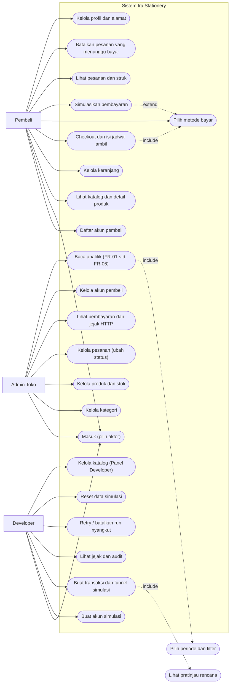

Hubungan antar use case:

- **Checkout `<<include>>` Pilih metode bayar** — checkout selalu berlanjut ke
  pemilihan metode; tidak ada checkout tanpa metode.
- **Simulasikan pembayaran `<<extend>>` Pilih metode bayar** — simulasi hanya
  terjadi setelah metode dipilih (lewat QR atau tombol buka halaman simulasi).
- **Baca analitik `<<include>>` Pilih periode dan filter** — setiap halaman
  analitik selalu dibaca dalam satu periode dan filter asal data.
- **Buat transaksi `<<include>>` Lihat pratinjau rencana** — pratinjau wajib
  sebelum eksekusi, kecuali Buat Akun yang langsung menyimpan.

### 1.1 Daftar use case dan rutenya

| Use case | Aktor | Rute / aksi |
| --- | --- | --- |
| Daftar akun pembeli | Pembeli | `GET/POST /daftar` |
| Masuk (pilih aktor) | Semua | `GET/POST /masuk` (`?aktor=pembeli`, `admin_toko`, atau `developer`) |
| Lihat katalog dan detail produk | Pembeli (tamu boleh lihat) | `GET /`, `GET /katalog`, `GET /produk/{produk}` |
| Kelola keranjang | Pembeli | `GET /keranjang`, `POST /keranjang/tambah`, `PUT /keranjang/{item}`, `DELETE /keranjang/{item}` |
| Checkout dan isi jadwal ambil | Pembeli | `GET/POST /checkout` (jadwal ambil wajib) |
| Pilih metode bayar | Pembeli | `GET /pesanan/{order}/bayar` |
| Simulasikan pembayaran | Pembeli | `GET /pay/sim/{token}`, `POST /pay/sim/{token}/bayar`, `POST /pay/sim/{token}/gagal` |
| Lihat pesanan dan struk | Pembeli | `GET /pesanan`, `GET /pesanan/{order}`, `GET /pembayaran/{payment}/hasil`, `GET /pembayaran/{payment}/struk` |
| Batalkan pesanan yang menunggu bayar | Pembeli | `POST /pesanan/{order}/batal` |
| Kelola profil dan alamat | Pembeli | `GET /profil`, `GET /profil/ubah`, `PUT /profil`, `PUT /profil/alamat` |
| Kelola kategori | Admin Toko | `GET /admin/kategori` (+ CRUD) |
| Kelola produk dan stok | Admin Toko | `GET /admin/produk` (+ CRUD, `POST /admin/produk/{produk}/stok`) |
| Kelola pesanan (ubah status) | Admin Toko | `GET /admin/pesanan`, `GET /admin/pesanan/{order}`, `POST /admin/pesanan/{order}/status` |
| Lihat pembayaran dan jejak HTTP | Admin Toko | `GET /admin/pembayaran`, `GET /admin/pembayaran/{payment}` (hanya-baca) |
| Kelola akun pembeli | Admin Toko | `GET /admin/akun-pembeli` (aktifkan/nonaktifkan) |
| Baca analitik (FR-01 s.d. FR-06) | Admin Toko | `GET /admin`, `GET /admin/tren`, `GET /admin/funnel`, `GET /admin/perbandingan`, `GET /admin/aktivitas`, `GET /admin/aktivitas/riwayat`, `GET /admin/kategori-analisis` |
| Buat akun simulasi | Developer | `GET /developer/akun/buat`, `POST /developer/akun` (maks 100/request, tanpa pratinjau) |
| Buat transaksi dan funnel simulasi | Developer | `GET/POST /developer/transaksi/user`, `GET/POST /developer/transaksi/periode`, `GET/POST /developer/funnel` |
| Lihat jejak dan audit | Developer | `GET /developer/run`, `GET /developer/run/{run}` |
| Retry / batalkan run nyangkut | Developer | `POST /developer/run/{run}/retry`, `POST /developer/run/{run}/cancel` |
| Reset data simulasi | Developer | `GET/POST /developer/reset` (frasa `HAPUS RUN` / `HAPUS SEMUA SIMULASI`) |
| Kelola katalog (Panel Developer) | Developer | `GET /developer/produk`, `GET /developer/kategori` (+ CRUD, produk punya isian `release_date`) |

---

## 2. Diagram Aktivitas

### 2.1 Belanja dan Bayar (Pembeli)

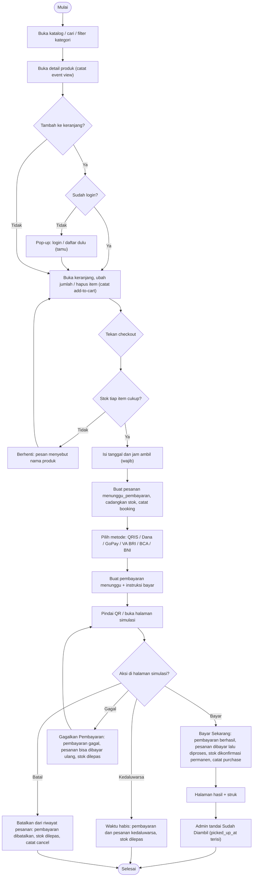

Langkah-langkahnya (sama dengan diagram di atas, ditulis kata-kata):

1. Pembeli membuka katalog (`/katalog`) — boleh tanpa login untuk melihat.
2. Pembeli mencari dengan kata kunci, memfilter berdasarkan kategori,
   dan mengurutkan hasil bila tersedia.
3. Pembeli membuka detail produk (`/produk/{produk}`); langkah ini mencatat
   event `view`.
4. Pembeli melihat harga, stok, dan deskripsi.
5. Bila stok habis, tombol tambah ke keranjang tidak aktif dan ada keterangan
   stok habis. Bila produk tidak ditemukan, tampil keadaan tidak ditemukan
   dengan satu aksi kembali yang jelas.
6. Pembeli menekan tambah ke keranjang; langkah ini mencatat event
   `add-to-cart`. Tamu yang menekan tombol beli mendapat pop-up untuk login
   atau daftar dulu.
7. Pembeli membuka keranjang (`/keranjang`): daftar item, jumlah, harga
   satuan, subtotal, dan total.
8. Pembeli mengubah jumlah atau menghapus item; subtotal dan total diperbarui
   langsung. Jumlah tidak boleh melebihi stok dan tidak boleh nol atau negatif.
9. Pembeli menekan checkout dari keranjang (wajib sudah login).
10. Sistem memeriksa: keranjang tidak kosong, dan stok tiap item masih cukup.
    Bila ada item yang stoknya tidak cukup, checkout berhenti pada item itu
    dengan pesan yang menyebut nama produknya.
11. Pembeli mengisi **tanggal dan jam ambil (wajib)** — ini jadwal pengambilan
    barang di toko.
12. Bila lolos, sistem membuat pesanan dengan status `menunggu_pembayaran`,
    mencatat event `booking`, dan mencadangkan stok tiap item pesanan, supaya
    tidak dibeli orang lain untuk jumlah yang sama.
13. Pembeli melihat ringkasan pesanan dan enam kartu metode: QRIS, Dana,
    GoPay, Virtual Account BRI, Virtual Account BCA, Virtual Account BNI.
14. Pembeli memilih satu metode; tombol lanjut tidak aktif sebelum metode
    dipilih.
15. Sistem membuat satu pembayaran untuk pesanan itu dengan status
    `menunggu`, total sama persis dengan total pesanan, dan waktu kedaluwarsa.
16. Pembeli diarahkan ke halaman instruksi pembayaran
    (`/pesanan/{order}/bayar`): nomor pesanan, total, metode, hitung mundur
    kedaluwarsa, dan — untuk QRIS/Dana/GoPay QR besar; untuk Virtual Account
    nomor besar yang bisa disalin plus QR kecil. QR ini mengarah ke halaman
    simulasi pembayaran (`/pay/sim/{token}`), bukan QR pembayaran riil.
17. Pembeli memindai QR dengan kamera HP atau Google Lens, atau menekan
    tombol "Buka Halaman Simulasi Pembayaran".
18. Halaman simulasi menampilkan ringkasan pesanan, hitung mundur, dan tiga
    aksi: **Bayar Sekarang**, **Gagalkan Pembayaran**, dan
    **Kembali ke Pesanan**.
19. **Cabang A — Bayar berhasil:** pembeli menekan Bayar Sekarang. Status
    pembayaran menjadi `berhasil`, status pesanan menjadi `dibayar` (lalu
    `diproses`), cadangan stok dikonfirmasi menjadi pengurangan permanen,
    event `purchase` tercatat, dan pembeli diarahkan ke halaman hasil berhasil.
20. **Cabang B — Gagal:** pembeli menekan Gagalkan Pembayaran. Status
    pembayaran menjadi `gagal`, pesanan kembali ke keadaan yang memungkinkan
    bayar ulang, cadangan stok dilepas, dan event `purchase` tidak tercatat.
21. **Cabang C — Kedaluwarsa:** bila waktu habis dan belum dibayar, status
    pembayaran menjadi `kedaluwarsa`, pesanan menjadi `kedaluwarsa`, dan
    cadangan stok dilepas.
22. **Cabang D — Token dipakai ulang:** bila QR atau tautan dibuka lagi setelah
    pembayaran sudah final, sistem menolak perubahan dan menampilkan pesan
    status final, bukan tombol aksi.
23. **Cabang E — Pembatalan oleh pembeli:** pembeli bisa membatalkan pesanan
    yang masih menunggu pembayaran dari riwayat pesanan
    (`/pesanan/{order}/batal`); status pembayaran menjadi `dibatalkan`,
    cadangan stok dilepas, dan event `cancel` tercatat.
24. Pembeli yang sudah berhasil membayar bisa membuka struk simulasi
    (`/pembayaran/{payment}/struk`).
25. Saat pembeli mengambil barang di toko, admin menandai pesanan
    `selesai` — saat itulah `picked_up_at` terisi (lihat §2.2 langkah 5).

### 2.2 Kelola Toko (Admin Toko)

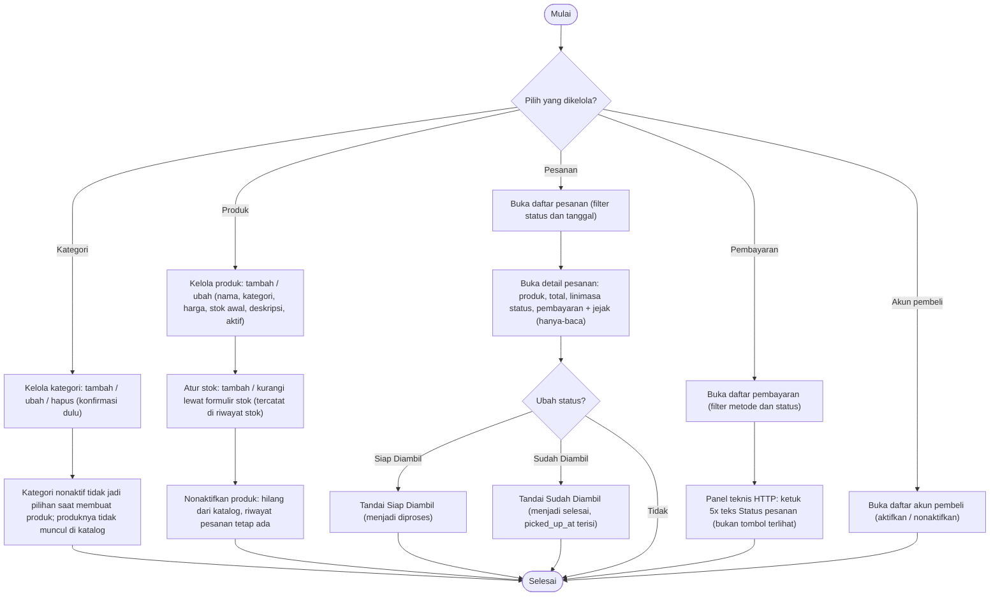

Langkah-langkahnya:

1. Admin membuka daftar kategori (`/admin/kategori`).
2. Admin menambah kategori baru: isi nama, tentukan aktif atau tidak, lalu
   simpan.
3. Admin mengubah kategori: ubah nama atau statusnya, lalu simpan.
4. Admin menghapus kategori: sistem meminta konfirmasi dulu, baru menghapus.
5. Kategori yang nonaktif tidak muncul sebagai pilihan saat admin membuat
   produk, dan produk di kategori itu tidak muncul di katalog pembeli.
6. Admin membuka daftar produk (`/admin/produk`).
7. Admin menambah produk: isi nama, pilih kategori, isi harga, isi stok
   awal, isi deskripsi singkat, tentukan aktif atau tidak, lalu simpan.
8. Admin mengubah produk: ubah isian yang sama, lalu simpan.
9. Admin mengatur stok: tambah atau kurangi stok lewat formulir stok
   (`/admin/produk/{produk}/stok`); setiap perubahan tercatat di riwayat stok.
10. Admin menonaktifkan produk: produk langsung hilang dari katalog pembeli,
    tetapi riwayat pesanannya tetap ada.
11. **Titik siap:** toko dinyatakan siap menerima pembeli hanya bila minimal
    ada satu kategori aktif dan satu produk aktif dengan stok tersedia.
12. Admin membuka daftar pesanan (`/admin/pesanan`) dengan filter status dan
    tanggal.
13. Admin membuka detail satu pesanan: daftar produk, total, linimasa status,
    dan detail pembayaran beserta jejaknya (hanya-baca).
14. Admin mengubah status pesanan lewat tombol yang diberi label sesuai
    maknanya: "Tandai Siap Diambil" (menjadi `diproses`) dan
    "Tandai Sudah Diambil" (menjadi `selesai`).
15. Saat status menjadi `selesai`, sistem mengisi `picked_up_at` dengan waktu
    saat itu — inilah catatan bahwa barang sudah diambil pembeli (dan sudah
    dibayar, untuk alur toko yang sebenarnya).
16. Admin **tidak** mengubah status pembayaran secara manual dari layar ini.
    Status pembayaran hanya berubah lewat aksi simulasi pembeli, kedaluwarsa,
    atau pembatalan yang sah.
17. Admin membuka daftar pembayaran (`/admin/pembayaran`) dengan filter
    metode dan status, lalu membuka detail satu pembayaran beserta jejak
    HTTP-nya (hanya-baca). Panel teknis HTTP hanya terbuka lewat ketukan 5x
    pada teks "Status pesanan" di bagian Ringkasan Pembayaran — bukan tombol
    yang terlihat langsung.
18. Admin membuka daftar akun pembeli (`/admin/akun-pembeli`) dan dapat
    menonaktifkan akun bila perlu.

### 2.3 Hasilkan Analitik (Admin Toko)

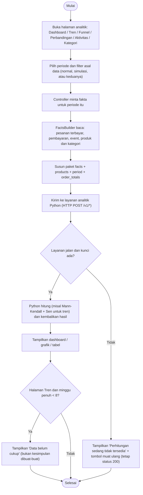

Langkah-langkahnya. Perhatikan: proses ini **hanya membaca** data toko.
Tidak ada satu pun panah tulis dari proses ini ke penyimpanan toko.

1. Admin memilih halaman analitik dan periode (rentang tanggal) beserta asal
   data (normal, simulasi, atau keduanya).
2. Sistem membaca pesanan yang pembayarannya berhasil pada periode itu.
   Pesanan yang masih menunggu, gagal, kedaluwarsa, atau dibatalkan tidak
   dihitung sebagai penjualan.
3. Sistem membaca pembayaran dan event aktivitas pada periode yang sama.
4. Sistem membaca produk dan kategori untuk memberi nama pada angka.
5. Sistem menyusun paket fakta (`facts`, `products`, `period`) plus
   `order_totals` — jumlah pesanan unik yang dibayar, bukan jumlah per produk,
   supaya pesanan berisi dua kategori tidak terhitung ganda.
6. Bila `order_totals` tidak tersedia, jumlah transaksi ditampilkan sebagai
   "Belum dapat dihitung" (bukan 0, bukan jumlah per produk), lengkap dengan
   peringatan.
7. Laravel mengirim paket fakta ke layanan analitik Python (HTTP, `POST /v1/*`).
   Delapan endpoint yang tersedia:
   - `/v1/summary` — ringkasan penjualan dan transaksi (FR-01).
   - `/v1/trend` — tren per produk, Mann–Kendall + Sen's slope (FR-02).
   - `/v1/funnel` — funnel dilihat → keranjang → booking → pembelian (FR-03).
   - `/v1/compare` — perbandingan dua periode, uji binomial (FR-04).
   - `/v1/interest` — minat produk, interval Wilson (FR-05).
   - `/v1/category` — performa per kategori dan kelompok harga (FR-06).
   - `/v1/category-compare` — perbandingan kategori antar dua periode (FR-06).
   - `/v1/insight` — kalimat insight dari angka yang tampil (INS-01–INS-06).
8. Setiap endpoint hanya menerima kunci yang memang dia kenali — kunci yang
   tidak dikenal ditolak dengan pesan yang menyebut namanya.
9. Layanan mengembalikan hasil hitungan terstruktur (label, kekuatan bukti,
   jumlah, periode, filter, `algorithm_version`, `warnings`) — tanpa pernah
   menyentuh basis data dan tanpa pernah mengubah data toko.
10. Bila layanan tidak jalan atau kuncinya kosong, halaman menampilkan
    "Perhitungan sedang tidak tersedia" dengan tombol muat ulang — tetap
    status 200, bukan halaman error mentah.
11. Admin membuka Dashboard (`/admin`): ringkasan penjualan, jumlah
    transaksi, produk terlaris, produk paling sedikit terjual, dan grafik
    penjualan.
12. Admin membuka Tren (`/admin/tren`): produk yang trennya naik dan turun.
    Syarat tampil: minimal **8 minggu penuh** — bila kurang, tampil
    "Data belum cukup", bukan kesimpulan yang dibuat-buat.
13. Admin membuka Funnel (`/admin/funnel`): jumlah dan persentase konversi
    antar-tahap, lengkap dengan alasan bila satu tahap kosong.
14. Admin membuka Perbandingan (`/admin/perbandingan`), Aktivitas dan Minat
    (`/admin/aktivitas`, beserta Riwayat Aktivitas), dan Kategori
    (`/admin/kategori-analisis`).
15. Setiap angka bisa ditelusur kembali ke transaksi dan event sumbernya.
16. Mengganti filter periode atau asal data memperbarui grafik dan tabel
    secara bersamaan, bukan hanya salah satunya.

### 2.4 Hasilkan Data Simulasi (Developer)

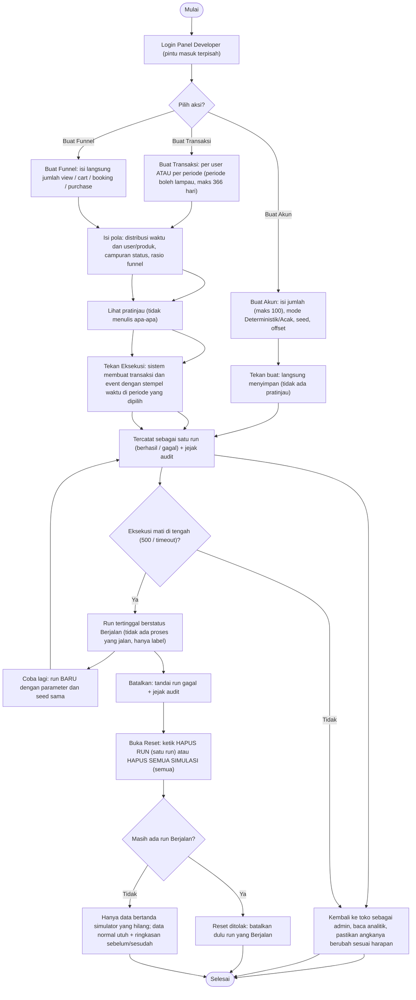

Langkah-langkahnya:

1. Developer login ke panel developer (`/masuk`, pilih aktor Developer).
2. Developer membuka "Buat Akun Simulasi" (`/developer/akun/buat`).
3. Developer mengisi jumlah akun — **maksimal 100 akun per request**.
   Jumlah di atas itu ditolak dengan pesan yang jelas, bukan diam-diam dipotong.
4. Developer memilih mode biodata: Deterministik (seed yang sama + isian yang
   sama = hasil yang sama persis) atau Acak, dan mengisi offset bila sudah
   pernah membuat akun sebelumnya (offset 10 berarti lanjut dari akun ke-11).
5. Developer menekan "Buat akun simulasi". Halaman ini **tidak punya langkah
   pratinjau** — tombolnya langsung menyimpan.
6. Akun simulasi yang dibuat langsung bisa dipakai sebagai akun pembeli biasa
   dari sisi toko, tetapi tetap bertanda simulator pada jejak developer dan
   pada filter asal data di analitik.
7. Developer melihat daftar akun simulasi (`/developer/akun-simulasi`).
8. Developer memilih cara membuat transaksi, salah satu dari dua:
   - **Per user** (`/developer/transaksi/user`): pilih satu akun simulasi,
     tentukan jumlah transaksi, item per transaksi, dan kuantitas.
   - **Per periode** (`/developer/transaksi/periode`): pilih periode
     (boleh periode yang sudah lewat, maksimal 366 hari), tentukan jumlah
     transaksi (maksimal 500), dan cakupan akunnya — satu akun, beberapa akun,
     semua akun (dibatasi 100 akun pertama), atau acak sekian akun.
9. Developer mengisi pola yang menyertainya: distribusi waktu (Acak / Merata /
   Satu titik / Menaik / Menurun), distribusi user/produk (Acak / Merata /
   Berbobot), campuran status (misalnya Selesai 80 / Dibatalkan 10 /
   Kedaluwarsa 10), dan rasio funnel (misalnya 40%/60%).
10. Developer menekan "Lihat pratinjau": ringkasan apa yang akan dibuat
    (jumlah transaksi, jumlah event, rentang tanggal, akun yang terlibat).
    Pratinjau **tidak menulis apa-apa**.
11. Developer menekan "Eksekusi". Sistem membuat transaksi dan event dengan
    stempel waktu di dalam periode yang dipilih, bukan dengan waktu hari ini.
12. Setiap transaksi disertai event funnel yang relevan (`view`, `add-to-cart`,
    `booking`, `purchase`) dan variasi status yang wajar, supaya hasilnya bisa
    dibaca oleh dashboard, tren, funnel, dan perbandingan periode.
13. Bila gagal di tengah jalan, tidak boleh ada data setengah jadi yang
    tertinggal tanpa keterangan — satu eksekusi tercatat sebagai satu run
    (berhasil, gagal sebagian, atau gagal total).
14. Alternatif cepat tanpa transaksi: Developer membuka "Funnel"
    (`/developer/funnel`) dan mengisi langsung jumlah event per tahap
    (default 100/40/24/19; preset 200/120/40/0 "Minat tanpa pembelian" dan
    200/120/60/40 "Funnel lengkap"), lalu pratinjau dan eksekusi seperti biasa.
15. Developer kembali ke toko sebagai admin dan membaca analitik dari data
    tersebut untuk memastikan angkanya berubah sesuai harapan.
16. **Bila eksekusi mati di tengah jalan** (misalnya error 500 karena timeout
    30 detik pada run yang berat), run-nya tertinggal berstatus `Berjalan`
    — padahal tidak ada proses yang sedang jalan, hanya labelnya. Dua jalan
    keluarnya, keduanya di Jejak & Audit (`/developer/run`):
    - **Coba lagi** — membuat run BARU dengan parameter dan seed yang sama
      (bukan melanjutkan run yang mati). Hati-hati: run yang berat akan
      timeout lagi — pecah jadi run yang lebih kecil.
    - **Batalkan** — menandai run itu `gagal` dengan catatan "Dibatalkan
      manual" plus jejak audit.
17. Developer membuka "Jejak dan Audit" (`/developer/run`): daftar semua aksi
    simulator — kapan, aksi apa, berapa banyak, untuk periode apa, hasilnya apa.
18. Developer membuka detail satu run (`/developer/run/{run}`) untuk melihat
    pratinjau dan hasil yang pernah dibuatnya.
19. Bila perlu mengulang dengan pola berbeda, developer membuka Reset
    (`/developer/reset`).
20. Sistem meminta konfirmasi eksplisit: ketik frasa `HAPUS RUN` untuk menghapus
    satu run, atau `HAPUS SEMUA SIMULASI` untuk menghapus semua data simulasi.
    Tombol baru aktif bila ketikannya persis.
21. Reset **ditolak selama masih ada run berstatus `Berjalan`** — batalkan dulu
    run yang nyangkut (langkah 16), baru reset bisa jalan.
22. Setelah reset, **hanya data bertanda simulator yang hilang**. Data pemakaian
    normal tetap utuh, dan sistem menampilkan ringkasan sebelum/sesudah
    (jumlah baris data normal tidak berubah) supaya reset bisa diverifikasi.
23. Developer bisa mengulang simulasi dengan pola berbeda setelah reset.

---

## 3. Diagram Sekuens

### 3.1 Checkout dan Pembayaran

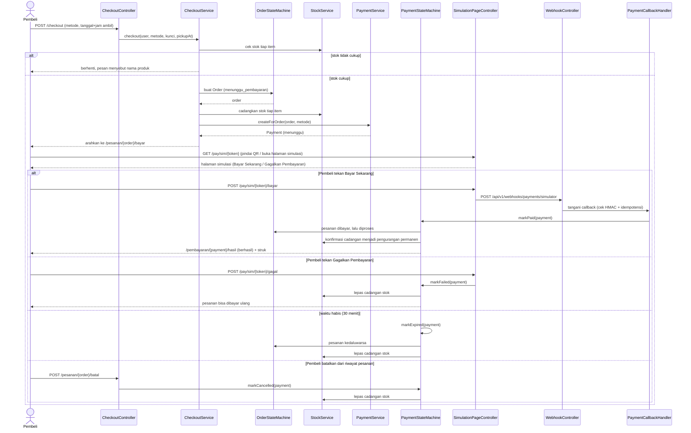

Yang perlu diperhatikan dari diagram ini:

- **Satu-satunya jalan uang masuk** adalah lewat webhook simulator
  (`POST /api/v1/webhooks/payments/{provider}`) dengan tanda tangan HMAC dan
  kunci idempotensi — tidak ada aksi lain yang bisa mengubah status pembayaran
  menjadi `berhasil`.
- **Stok dicadangkan saat checkout, dikonfirmasi permanen hanya saat
  pembayaran berhasil**, dan dilepas pada semua cabang gagal (gagal,
  kedaluwarsa, dibatalkan).
- **Pembelian dihitung saat dibayar** (`paid_at` terisi) — bukan saat pesanan
  dibuat dan bukan saat admin menandai selesai. Karena itu analitik membaca
  `paid_at`, bukan status pesanan (lihat §2.3 langkah 2).
- Admin tidak ada di diagram ini: admin **tidak bisa** mengubah status
  pembayaran secara manual.

### 3.2 Jalankan Simulasi (Pratinjau → Eksekusi, Retry, Cancel)

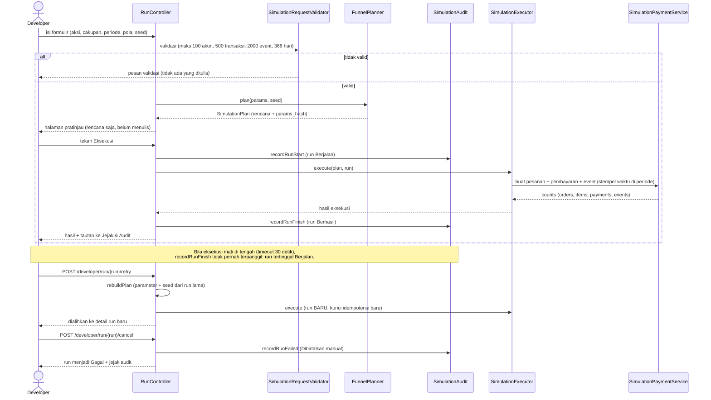

Yang perlu diperhatikan dari diagram ini:

- **Pratinjau tidak menulis apa-apa.** Yang ditulis baru terjadi saat
  Eksekusi; pratinjau hanya membangun rencana (`SimulationPlan`).
- **Satu eksekusi = satu run.** Semua tulis dalam satu eksekusi berhasil
  atau gagal bersama — tidak ada data setengah jadi tanpa keterangan.
- **Retry bukan melanjutkan run yang mati** — retry membangun ulang rencana
  yang sama persis (parameter + seed dari run lama) dan mengeksekusinya
  sebagai run baru dengan kunci idempotensi baru.
- **Cancel tidak mematikan proses** — memang tidak ada proses yang sedang
  jalan. Cancel hanya menandai run yang nyangkut menjadi `gagal` plus jejak
  audit, supaya reset tidak lagi terhalang (lihat §2.4 langkah 21).

### 3.3 Hasilkan Analitik

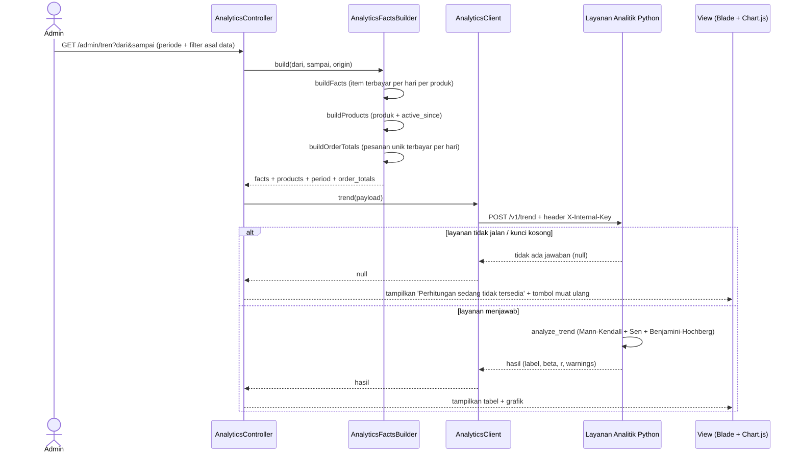

Yang perlu diperhatikan dari diagram ini:

- **Laravel tidak menghitung apa-apa sendiri.** Semua hitungan (tren,
  funnel, perbandingan, minat, kategori) terjadi di layanan Python; Laravel
  hanya menyiapkan fakta dan menampilkan hasil.
- **Fakta tidak membawa data pribadi** — hanya angka per hari per produk
  (maksimal ~15.000 baris: 366 hari × ~40 produk), tanpa nama, email,
  atau alamat pembeli.
- **Kunci internal wajib ada** (`X-Internal-Key`). Layanan Python menolak
  start bila kuncinya kosong, dan menolak request tanpa kunci yang benar.
- **Penjualan dihitung dari `paid_at`, bukan dari status pesanan.** Pesanan
  yang sudah maju ke `diproses` ("Siap Diambil") atau `selesai` tetap
  dihitung, karena `paid_at`-nya sudah terisi sejak dibayar.

---

## 4. Diagram Kelas

### 4.1 Model domain (tabel di basis data)

```mermaid
classDiagram
    class User {
        +int id
        +string name
        +string email
        +string role
        +string origin
        +bool is_active
        +string username
        +string phone
        +string gender
        +date birthdate
        +string simulation_run_id
    }
    class Developer {
        +int id
        +string name
        +string email
        +string role
    }
    class Category {
        +int id
        +string name
        +string slug
    }
    class Product {
        +int id
        +int category_id
        +string name
        +string description
        +int price_idr
        +int stock_on_hand
        +int stock_reserved
        +bool is_active
        +date release_date
    }
    class Cart {
        +int id
        +int user_id
    }
    class CartItem {
        +int id
        +int cart_id
        +int product_id
        +int quantity
    }
    class Order {
        +string id
        +string order_number
        +int user_id
        +string status
        +int total_idr
        +datetime payment_deadline_at
        +datetime paid_at
        +datetime picked_up_at
        +datetime pickup_at
        +string checkout_key
        +string origin
        +string simulation_run_id
    }
    class OrderItem {
        +int id
        +int order_id
        +int product_id
        +string product_name_snapshot
        +int unit_price_idr
        +int quantity
        +int subtotal_idr
        +string origin
        +string simulation_run_id
    }
    class Payment {
        +int id
        +int order_id
        +int user_id
        +string provider
        +string payment_method
        +int amount_idr
        +string status
        +string reference_code
        +string payment_token
        +string qr_url
        +datetime expires_at
        +datetime paid_at
        +bool is_simulated
        +string origin
        +string simulation_run_id
    }
    class Event {
        +int id
        +string event_type
        +int user_id
        +int product_id
        +int order_id
        +datetime occurred_at
        +string origin
        +string simulation_run_id
    }
    class Address {
        +int id
        +int user_id
        +string recipient_name
        +string recipient_phone
        +string province
        +string city
        +string street_address
        +string address_type
    }
    class StockMovement {
        +int id
        +int product_id
        +string type
        +int delta_on_hand
        +int delta_reserved
        +int order_id
        +string actor_type
    }
    class OrderStatusHistory {
        +int id
        +int order_id
        +string from_status
        +string to_status
        +string trigger
        +string actor_type
    }
    class PaymentStatusTransition {
        +int id
        +int payment_id
        +string from_status
        +string to_status
        +string trigger
    }
    class PaymentHttpTrace {
        +int id
        +int payment_id
        +int order_id
        +string kind
        +string method
        +string path
        +int response_status
        +datetime occurred_at
    }
    class SimulationRun {
        +string id
        +int developer_id
        +string action
        +string seed
        +date period_start
        +date period_end
        +string status
        +string error_message
        +string idempotency_key
        +datetime started_at
        +datetime finished_at
    }
    class SimulationAuditLog {
        +int id
        +int developer_id
        +string action
        +string run_id
        +string outcome
        +datetime occurred_at
    }

    User "1" -- "*" Address : punya
    User "1" -- "1" Cart : punya
    User "1" -- "*" Order : membuat
    User "1" -- "*" Payment : membayar
    User "1" -- "*" Event : melakukan
    Developer "1" -- "*" SimulationRun : menjalankan
    SimulationRun "1" -- "*" SimulationAuditLog : dicatat di
    Category "1" -- "*" Product : berisi
    Product "1" -- "*" OrderItem : dibeli sebagai
    Product "1" -- "*" CartItem : dimasukkan sebagai
    Product "1" -- "*" StockMovement : berubah lewat
    Product "1" -- "*" Event : dilihat / dibeli
    Cart "1" -- "*" CartItem : berisi
    CartItem "*" -- "1" Product : merujuk
    Order "1" -- "*" OrderItem : berisi
    Order "1" -- "*" Payment : dibayar lewat
    Order "1" -- "*" OrderStatusHistory : berubah lewat
    Order "1" -- "*" Event : menghasilkan
    OrderItem "*" -- "1" Product : merujuk
    Payment "1" -- "*" PaymentStatusTransition : berubah lewat
    Payment "1" -- "*" PaymentHttpTrace : dicatat di
```

Catatan tentang diagram ini:

- **Tiga kolom penanda simulasi** muncul di hampir semua tabel transaksi:
  `origin` (`normal` atau `developer_simulation`), `is_simulated`, dan
  `simulation_run_id`. Ketiganya hanya metadata — tidak ada label SIMULASI
  di layar pembeli dan admin.
- **`Order` dan `SimulationRun` memakai string sebagai id** (bukan angka
  berurutan): nomor pesanan untuk `Order`, ULID untuk `SimulationRun`.
- **Harga dan subtotal dibekukan saat transaksi terjadi**
  (`unit_price_idr`, `subtotal_idr`, `product_name_snapshot` di `OrderItem`):
  mengubah harga produk belakangan tidak mengubah struk lama.
- **Riwayat tidak pernah dihapus, hanya ditambah** (`OrderStatusHistory`,
  `PaymentStatusTransition`, `PaymentHttpTrace`, `SimulationAuditLog`):
  tabel-tabel ini bersifat append-only, termasuk oleh reset simulasi —
  reset menghapus data simulasi, tetapi jejak auditnya tetap ada.

### 4.2 Layanan (logika di luar model)

```mermaid
classDiagram
    class OrderStateMachine {
        +transition(order, to, trigger, actor)
        +recordInitial(order, trigger, actor)
    }
    class PaymentStateMachine {
        +transition(payment, to, trigger)
        +markPaid(payment, trigger)
        +markFailed(payment, trigger)
        +markExpired(payment, trigger)
        +markCancelled(payment, actor, trigger)
    }
    class CheckoutService {
        +checkout(user, metode, kunci, pickupAt)
        +cancelOrder(user, order)
        +cartView(user)
    }
    class PaymentService {
        +methods()
        +createForOrder(order, metode)
        +instructionFor(payment)
    }
    class CartService {
        +cartFor(user)
        +viewFor(user)
        +add(user, product, qty)
        +updateQuantity(user, item, qty)
        +remove(user, item)
        +clear(user)
    }
    class CatalogService {
        +createCategory(data)
        +updateCategory(category, data)
        +createProduct(data, actor)
        +updateProduct(product, data)
        +toggleProduct(product)
    }
    class StockService {
        +recordInitialStock(product, actor)
        +reserve(order, actorType, actorId)
        +confirm(order, actorType, actorId)
        +release(order, actorType, actorId)
        +adjust(product, qty, actor)
    }
    class AnalyticsFactsBuilder {
        +build(dari, sampai, origin)
        +buildFacts(dari, sampai, origin)
        +buildProducts()
        +buildCategories()
        +buildOrderTotals(dari, sampai, origin)
    }
    class AnalyticsClient {
        +summary(payload)
        +trend(payload)
        +funnel(payload)
        +compare(payload)
        +interest(payload)
        +category(payload)
        +categoryCompare(payload)
        +insight(payload)
    }
    class SimulationRequestValidator {
        +validateUserScope(params)
        +validatePeriodFirst(params)
        +validateFunnel(params)
        +resolveUserScope(params)
    }
    class FunnelPlanner {
        +plan(params, seed)
        +planFunnel(params, seed)
    }
    class SimulationExecutor {
        +execute(plan, run)
    }
    class SimulationAudit {
        +recordRunStart(run, params)
        +recordRunFinish(run, counts)
        +recordRunFailed(run, pesan)
        +recordRunReset(run)
        +recordAction(developer, aksi, run, ringkasan)
    }
    class SimulationResetService {
        +resetRun(run, developer)
        +resetAll(developer)
    }
    class TimeDistributor {
        +distribute(jumlah, awal, akhir, mode)
    }

    CheckoutService --> OrderStateMachine : memakai
    CheckoutService --> StockService : memakai
    CheckoutService --> PaymentService : memakai
    PaymentService --> PaymentStateMachine : memakai
    AnalyticsFactsBuilder --> AnalyticsClient : memberi fakta ke
    AnalyticsClient --> PythonService : "POST /v1/* + X-Internal-Key"
    class PythonService {
        +string host
        +int port
    }
    note for PythonService "Layanan Analitik Python (server.py, 127.0.0.1:8001)"
    SimulationRequestValidator --> FunnelPlanner : memakai
    FunnelPlanner --> TimeDistributor : memakai
    SimulationExecutor --> SimulationAudit : mencatat lewat
    SimulationExecutor --> PaymentStateMachine : memakai
    SimulationResetService --> SimulationAudit : mencatat lewat
```

Pembagian kerja antar layanan:

- **Mesin status** (`OrderStateMachine`, `PaymentStateMachine`) adalah
  satu-satunya tempat yang boleh mengubah status. Controller dan service lain
  tidak mengubah status secara langsung — mereka memanggil mesin ini, supaya
  setiap perubahan tercatat di riwayat.
- **Checkout dan pembayaran** (`CheckoutService`, `PaymentService`,
  `CartService`, `CatalogService`, `StockService`) mengurus alur toko.
- **Analitik** (`AnalyticsFactsBuilder`, `AnalyticsClient`) mengurus alur
  baca: builder menyiapkan fakta dari basis data, client mengirimnya ke
  layanan Python dan menerima hasil.
- **Simulator** (`SimulationRequestValidator`, `FunnelPlanner`,
  `TimeDistributor`, `SimulationExecutor`, `SimulationAudit`,
  `SimulationResetService`) mengurus alur tulis data eksperimental: validasi
  → rencana → eksekusi → audit → reset.

---

## 5. Diagram Mesin Status

### 5.1 Status pembayaran

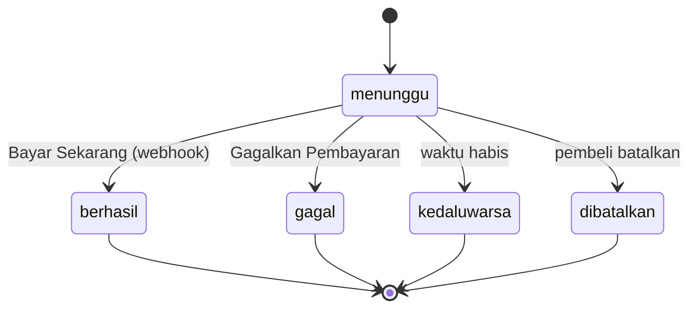

Status akhir (berhasil, gagal, kedaluwarsa, dibatalkan) tidak bisa diubah lagi.
Satu-satunya jalan ke `berhasil` adalah lewat webhook simulator — admin tidak
bisa mengubah status pembayaran secara manual.

### 5.2 Status pesanan

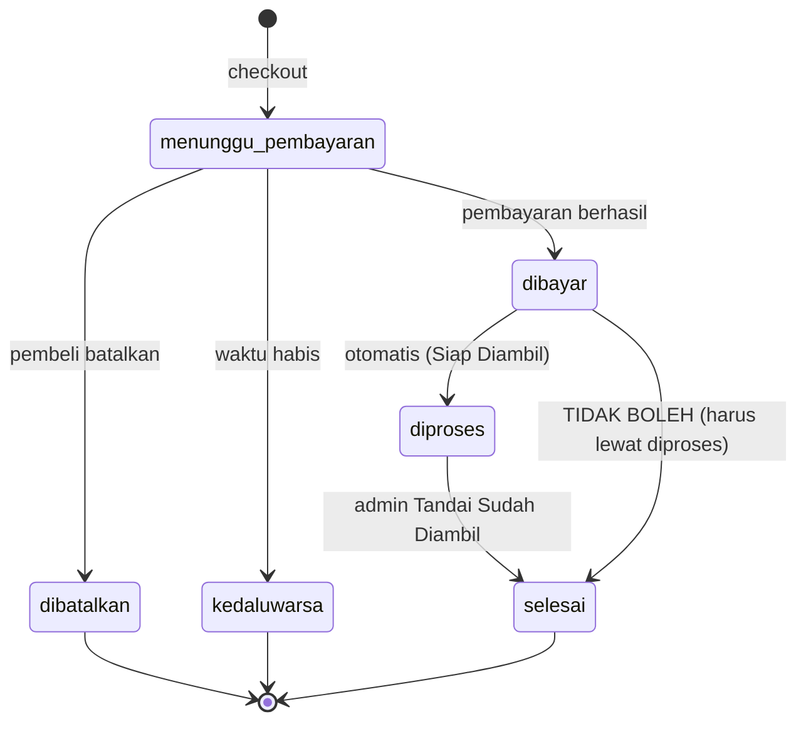

| Status pembayaran | Status pesanan yang tampil | Event analitik |
| --- | --- | --- |
| Menunggu | Menunggu pembayaran | `booking` sudah tercatat saat pesanan dibuat |
| Berhasil | Dibayar, lalu Diproses | `purchase` tercatat |
| Gagal | Menunggu pembayaran ulang atau dibatalkan | Tidak ada `purchase` |
| Kedaluwarsa | Kedaluwarsa | Tidak ada `purchase` |
| Dibatalkan | Dibatalkan | Tidak ada `purchase` |

Admin lalu dapat mengubah `diproses` menjadi `selesai` — dan saat itulah
`picked_up_at` terisi (lihat §2.2 langkah 15). Pesanan yang sudah dibayar
**tidak bisa dibatalkan** — tidak ada panah dari `dibayar`/`diproses`/
`selesai` ke `dibatalkan`.

### 5.3 Stok, dalam bahasa alur

1. Saat pesanan dibuat, stok produk dicadangkan.
2. Saat pembayaran berhasil, cadangan itu dikonfirmasi menjadi pengurangan
   stok yang permanen.
3. Saat pembayaran gagal, kedaluwarsa, atau dibatalkan, cadangan itu dilepas
   kembali.
4. Stok tidak boleh berkurang dua kali untuk satu pembayaran yang sama, dan
   tidak boleh menjadi negatif.

---

## 6. Kamus data

| Kode | Isi | Tabel di repo |
| --- | --- | --- |
| **D1** | Kategori dan produk, harga, stok, riwayat perubahan stok, tanggal mulai jual | `categories`, `products`, `stock_movements` |
| **D2** | Keranjang tiap pembeli dan isinya | `carts`, `cart_items` |
| **D3** | Pesanan, isi pesanan, riwayat status pesanan, `pickup_at`, `paid_at`, `picked_up_at` | `orders`, `order_items`, `order_status_histories` |
| **D4** | Pembayaran, metode, status, jejak HTTP simulasi, transisi status | `payments`, `payment_http_traces`, `payment_status_transitions` |
| **D5** | Event aktivitas: `view`, `add-to-cart`, `booking`, `purchase`, `cancel` | `events` |
| **D6** | Akun pembeli (profil + alamat), akun developer, akun admin | `users`, `addresses`, `developers` |
| **D7** | Sesi simulasi (run) dan jejak audit simulator | `simulation_runs`, `simulation_audit_logs` |

Catatan tentang D3: `pickup_at` adalah jadwal ambil yang diisi pembeli saat
checkout (wajib); `paid_at` terisi saat pembayaran berhasil; `picked_up_at`
terisi saat admin mengubah status pesanan menjadi `selesai` — itulah momen
tercatatnya "barang sudah diambil (dan sudah dibayar, untuk alur toko yang
sebenarnya)". Sebelum itu nilainya kosong.

Catatan tentang asal data: setiap baris di D3, D4, dan D5 membawa penanda asal —
data normal atau data simulasi. Penanda ini **hanya metadata**: tidak ada lagi
label SIMULASI di layar pembeli dan admin (keputusan 2026-11-08). Filter asal data
di analitik membaca penanda ini.

---

## 7. Yang belum ada di sistem (dicatat jujur, bukan disembunyikan)

1. **Tidak ada pengiriman (delivery).** Pembeli mengambil barang di toko.
2. **Tidak ada refund.** Pesanan yang sudah dibayar tidak bisa dikembalikan
   uangnya lewat sistem — sama seperti sistem lama.
3. **Tidak ada pembatalan otomatis karena tidak diambil.** Sistem lama dulu
   membatalkan pesanan `ready` yang lewat jadwal ambil + 1 jam beserta
   pengembalian stok; sistem baru belum punya aturan ini — pembatalan
   setelah dibayar masih ditangani manual oleh admin.
4. **Laporan penjualan tersendiri** belum ada — untuk sekarang laporan
   dibaca lewat Dashboard (FR-01).

---

## 8. Sumber

- `routes/web.php` dan `routes/api.php` — semua rute di dokumen ini diambil
  dari sana.
- Migrasi `000001`–`000019` di `database/migrations/` — semua tabel di kamus
  data (000017 `picked_up_at`, 000018 `pickup_at`, 000019 `release_date`).
- `app/Models/` — semua kelas dan relasi di §4.1; `app/Services/` dan
  `app/Simulation/` — semua layanan di §4.2.
- `python/analytics/server.py` — delapan endpoint `POST /v1/*` dan
  `GET /health`.
- `Blueprint-Workflow.md` (bagian W1–W11, §5) — alur layar dan keadaan tiap layar.
- `../../perencanaan/panduan-simulator-skenario.md` — resep skenario simulator
  (distribusi waktu, resep tren Naik/Turun, funnel, Perlu ditinjau).
- Keputusan Ren 2026-11-08: pembelian dihitung saat dibayar; stok berkurang
  saat pembayaran berhasil; label SIMULASI dihapus dari UI pembeli dan admin.
- Keputusan Ren 2026-11-09: jadwal ambil wajib diisi saat checkout; tombol
  selesai berlabel "Tandai Sudah Diambil".
- Keputusan Ren 2026-11-11: tombol retry/cancel untuk run simulasi yang
  nyangkut (retry = run baru dengan parameter dan seed sama; cancel = tandai
  gagal + jejak audit).
