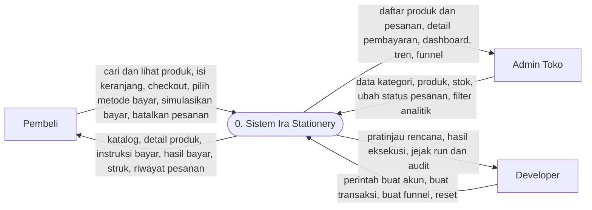
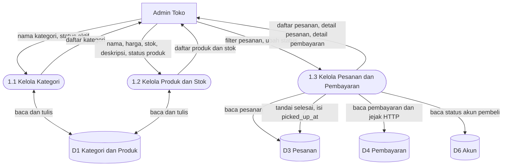
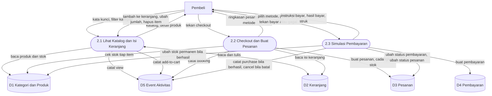
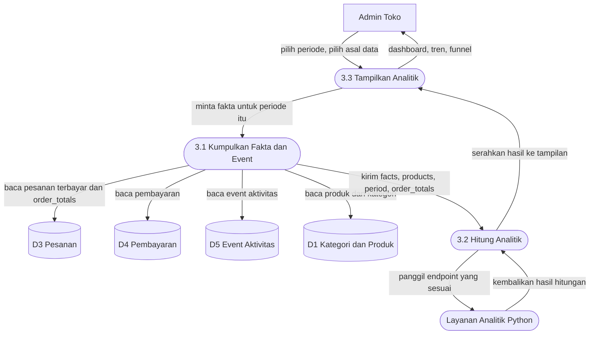
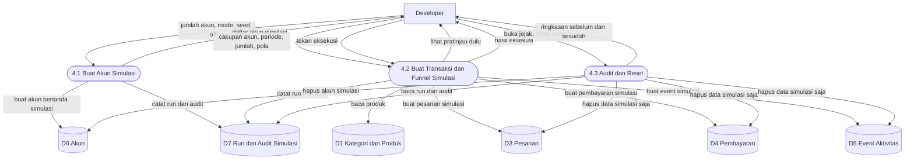

# Ira Stationery — Alur Kerja Sistem (Workflow + DFD)

> **Status:** Menggambarkan sistem **sebagaimana dibangun** per 2026-11-08
> (branch `feature/m5-analitik`, commit `e4cbbe3` per 2026-11-08 13:03 WITA;
> M4 sudah merge ke `main` di `2d4c6ec`, M5 langkah 1–6 di-gate 259 tes hijau,
> perbaikan generator biodata sudah di-push, gate ulang menunggu 261 hijau
> + cek manual langkah 7).
> **Pasangan file ini:** `Blueprint-Workflow.md` menjelaskan layar dan keadaan tiap layar
> untuk Figma. File ini menjelaskan **aliran datanya**: siapa mengirim apa ke mana,
> data apa yang disimpan, dan langkah manusia-nya dalam urutan bernomor.
> **Bahasa:** Indonesia. Mata uang Rupiah. Zona waktu WITA (Asia/Makassar).
> **Keputusan yang sudah masuk ke dokumen ini:** pembelian dihitung saat dibayar;
> stok berkurang permanen saat pembayaran berhasil; admin menandai `selesai`
> = barang sudah diambil (kolom `picked_up_at`); label SIMULASI sudah **dihapus**
> dari UI pembeli dan admin — asal data (normal/simulas) hanya tersimpan sebagai
> metadata dan dipakai sebagai filter di analitik, bukan sebagai label di layar.

## Cara membaca dokumen ini

- **Angka bernomor (1. 2. 3. …)** adalah langkah yang dilakukan manusia, dalam urutan.
  Contoh: 1. bangun; 2. cuci muka; 3. sikat gigi. Begitulah tiap alur di bawah ditulis.
- **Diagram (Mermaid)** adalah DFD — *Data Flow Diagram*. Legenda bentuknya:
  - **Persegi** = entitas luar (orang di luar sistem).
  - **Stadium (persegi bersudut sangat membulat)** = proses (kerja yang dilakukan sistem).
  - **Tabung** = penyimpanan data (tabel di basis data).
  - **Panah berlabel** = aliran data (tulisannya adalah data yang mengalir, bukan aksi).
- **Penomoran proses** mengikuti DFD: Diagram Konteks memakai proses `0`,
  Diagram Level 0 memakai `1.0`–`4.0`, Diagram Level 1 memecah tiap proses
  menjadi `x.1`, `x.2`, `x.3`. Jadi `2.3` artinya "proses ke-3 di dalam proses 2.0".
- **Nama tabel** di bagian penyimpanan data diambil dari migrasi yang benar-benar ada
  di repo, bukan dari karangan. Nama rute (`/katalog`, `/admin/tren`, …) juga
  diambil dari `routes/web.php` yang benar-benar ada.

## Aktor (hanya ada tiga)

| Aktor | Masuk lewat | Intinya |
| --- | --- | --- |
| **Pembeli** | Daftar dan login pembeli (`/daftar`, `/masuk`) | Melihat katalog, mengisi keranjang, checkout, mensimulasikan pembayaran, melihat pesanannya sendiri. |
| **Admin Toko** | Login admin (`/admin/masuk`) | Mengelola kategori, produk, stok, pesanan, pembayaran, akun pembeli; membaca analitik. |
| **Developer** | Login developer terpisah (`/developer/masuk`) | Membuka panel simulator: membuat akun dan transaksi eksperimental, melihat jejak, me-reset data simulasi saja. |

Satu orang tidak merangkap peran dalam satu sesi. Tiga pintu masuk itu terpisah.

---

## 1. Diagram Konteks (DFD Level -1: sistem sebagai satu kotak)

Satu proses saja: **0. Sistem Ira Stationery**. Semua yang dilakukan tiga aktor
masuk dan keluar lewat kotak ini.



Dibaca sebagai kalimat:

1. Pembeli mengirim pencarian, isi keranjang, dan pesanan; sistem mengembalikan katalog,
   instruksi bayar, hasil bayar, dan struk.
2. Admin mengirim data toko dan perintah ubah status; sistem mengembalikan daftar,
   detail, dan analitik.
3. Developer mengirim perintah simulasi; sistem mengembalikan pratinjau, hasil,
   dan jejak audit.

Tidak ada aktor keempat. Tidak ada uang riil yang mengalir ke kotak ini:
semua pembayaran adalah simulasi.

---

## 2. Diagram Level 0 (sistem dipecah menjadi 4 proses)

```mermaid
flowchart TD
    PEMBELI["Pembeli"]
    ADMIN["Admin Toko"]
    DEV["Developer"]

    subgraph SYS["Sistem Ira Stationery"]
        P1(["1.0 Kelola Toko"])
        P2(["2.0 Belanja dan Bayar"])
        P3(["3.0 Hasilkan Analitik"])
        P4(["4.0 Hasilkan Data Simulasi"])
    end

    D1[(D1 Kategori dan Produk)]
    D2[(D2 Keranjang)]
    D3[(D3 Pesanan)]
    D4[(D4 Pembayaran)]
    D5[(D5 Event Aktivitas)]
    D6[(D6 Akun)]
    D7[(D7 Run dan Audit Simulasi)]

    ADMIN -->|data kategori, produk, stok, status akun| P1
    P1 -->|daftar produk, kategori, akun pembeli| ADMIN
    P1 <-->|baca dan tulis| D1
    P1 <-->|baca dan tulis status akun| D6
    P1 -->|ubah status pesanan, tandai selesai| D3
    P1 -->|baca detail pembayaran| D4

    PEMBELI -->|cari, lihat, tambah ke keranjang, checkout, bayar| P2
    P2 -->|katalog, instruksi bayar, hasil, struk| PEMBELI
    P2 -->|baca produk dan stok| D1
    P2 <-->|baca dan tulis| D2
    P2 -->|buat pesanan, batalkan pesanan| D3
    P2 -->|buat dan ubah pembayaran| D4
    P2 -->|catat view, add-to-cart, booking, purchase, cancel| D5

    P3 -->|baca pesanan terbayar| D3
    P3 -->|baca pembayaran| D4
    P3 -->|baca event aktivitas| D5
    P3 -->|dashboard, tren, funnel| ADMIN

    DEV -->|perintah simulasi| P4
    P4 -->|pratinjau, hasil, jejak| DEV
    P4 -->|baca produk| D1
    P4 -->|buat akun simulasi| D6
    P4 -->|buat pesanan dan pembayaran simulasi| D3
    P4 -->|buat pembayaran simulasi| D4
    P4 -->|buat event simulasi| D5
    P4 <-->|baca dan tulis run dan audit| D7
```



Dibaca sebagai kalimat:

1. Admin mengelola toko lewat **1.0**; hasilnya tersimpan di D1 dan D6, dan status
   pesanan diubah di D3.
2. Pembeli berbelanja lewat **2.0**; keranjangnya di D2, pesanannya di D3,
   pembayarannya di D4, dan setiap aktivitasnya tercatat sebagai event di D5.
3. Admin membaca analitik lewat **3.0**; proses ini hanya membaca D3, D4, dan D5 —
   tidak pernah menulis data toko.
4. Developer mengisi data eksperimental lewat **4.0**; tulisannya masuk ke D3, D4, D5,
   dan D6 dengan tanda simulasi, dan setiap eksekusi tercatat di D7.

### 2.1 Penyimpanan data (kamus data)

| Kode | Isi | Tabel di repo |
| --- | --- | --- |
| **D1** | Kategori dan produk, harga, stok, riwayat perubahan stok | `categories`, `products`, `stock_movements` |
| **D2** | Keranjang tiap pembeli dan isinya | `carts`, `cart_items` |
| **D3** | Pesanan, isi pesanan, riwayat status pesanan, `picked_up_at` | `orders`, `order_items`, `order_status_histories` |
| **D4** | Pembayaran, metode, status, jejak HTTP simulasi | `payments`, `payment_http_traces` |
| **D5** | Event aktivitas: `view`, `add-to-cart`, `booking`, `purchase`, `cancel` | `events` |
| **D6** | Akun pembeli (profil + alamat), akun developer, akun admin | `users`, `addresses`, `developers` |
| **D7** | Sesi simulasi (run) dan jejak audit simulator | `simulation_runs`, `simulation_audit_logs` |

Catatan tentang D3: `picked_up_at` terisi saat admin mengubah status pesanan menjadi
`selesai` — itulah momen tercatatnya "barang sudah diambil (dan sudah dibayar,
untuk alur toko yang sebenarnya)". Sebelum itu nilainya kosong.

Catatan tentang asal data: setiap baris di D3, D4, dan D5 membawa penanda asal —
data normal atau data simulasi. Penanda ini **hanya metadata**: tidak ada lagi
label SIMULASI di layar pembeli dan admin (keputusan 2026-11-08). Filter asal data
di analitik membaca penanda ini.

---

## 3. Diagram Level 1 — Proses 1.0 Kelola Toko (Admin)

Proses 1.0 dipecah menjadi tiga:



### 3.1 Proses 1.1 — Kelola Kategori

1. Admin membuka daftar kategori (`/admin/kategori`).
2. Admin menambah kategori baru: isi nama, tentukan aktif atau tidak, lalu simpan.
3. Admin mengubah kategori: ubah nama atau statusnya, lalu simpan.
4. Admin menghapus kategori: sistem meminta konfirmasi dulu, baru menghapus.
5. Kategori yang nonaktif tidak muncul sebagai pilihan saat admin membuat produk,
   dan produk di kategori itu tidak muncul di katalog pembeli.

### 3.2 Proses 1.2 — Kelola Produk dan Stok

1. Admin membuka daftar produk (`/admin/produk`).
2. Admin menambah produk: isi nama, pilih kategori, isi harga, isi stok awal,
   isi deskripsi singkat, tentukan aktif atau tidak, lalu simpan.
3. Admin mengubah produk: ubah isian yang sama, lalu simpan.
4. Admin mengatur stok: tambah atau kurangi stok lewat formulir stok
   (`/admin/produk/{produk}/stok`); setiap perubahan tercatat di riwayat stok.
5. Admin menonaktifkan produk: produk langsung hilang dari katalog pembeli,
   tetapi riwayat pesanannya tetap ada.
6. Admin memeriksa katalog dari sisi pembeli: produk aktif muncul, produk
   nonaktif tidak muncul, stok tampil benar.
7. **Titik siap:** toko dinyatakan siap menerima pembeli hanya bila minimal ada
   satu kategori aktif dan satu produk aktif dengan stok tersedia.

### 3.3 Proses 1.3 — Kelola Pesanan dan Pembayaran

1. Admin membuka daftar pesanan (`/admin/pesanan`) dengan filter status dan tanggal.
2. Admin membuka detail satu pesanan: daftar produk, total, linimasa status,
   dan detail pembayaran beserta jejaknya (hanya-baca).
3. Admin mengubah status pesanan lewat tombol yang diberi label sesuai
   maknanya: "Tandai Siap Diambil" (menjadi `diproses`) dan
   "Tandai Sudah Diambil & Dibayar" (menjadi `selesai`).
4. Saat status menjadi `selesai`, sistem mengisi `picked_up_at` dengan waktu saat itu —
   inilah catatan bahwa barang sudah diambil pembeli (dan sudah dibayar,
   untuk alur toko yang sebenarnya).
5. Admin **tidak** mengubah status pembayaran secara manual dari layar ini.
   Status pembayaran hanya berubah lewat aksi simulasi pembeli, kedaluwarsa,
   atau pembatalan yang sah.
6. Admin membuka daftar pembayaran (`/admin/pembayaran`) dengan filter metode
   dan status, lalu membuka detail satu pembayaran beserta jejak HTTP-nya
   (hanya-baca). Panel teknis HTTP hanya terbuka lewat ketukan 5x pada teks
   "Status pesanan" di bagian Ringkasan Pembayaran — bukan tombol yang
   terlihat langsung.
7. Admin membuka daftar akun pembeli (`/admin/akun-pembeli`) dan dapat
   menonaktifkan akun bila perlu.

---

## 4. Diagram Level 1 — Proses 2.0 Belanja dan Bayar (Pembeli)

Proses 2.0 dipecah menjadi tiga:



### 4.1 Proses 2.1 — Lihat Katalog dan Isi Keranjang

1. Pembeli membuka katalog (`/katalog`) — boleh tanpa login untuk melihat.
2. Pembeli mencari dengan kata kunci, memfilter berdasarkan kategori,
   dan mengurutkan hasil bila tersedia.
3. Pembeli membuka detail produk (`/produk/{produk}`); langkah ini mencatat
   event `view` di D5.
4. Pembeli melihat harga, stok, dan deskripsi.
5. Bila stok habis, tombol tambah ke keranjang tidak aktif dan ada keterangan
   stok habis. Bila produk tidak ditemukan, tampil keadaan tidak ditemukan
   dengan satu aksi kembali yang jelas.
6. Pembeli menekan tambah ke keranjang; langkah ini mencatat event `add-to-cart`.
   Tamu yang menekan tombol beli mendapat pop-up untuk login atau daftar dulu.
7. Pembeli membuka keranjang (`/keranjang`): daftar item, jumlah, harga satuan,
   subtotal, dan total.
8. Pembeli mengubah jumlah atau menghapus item; subtotal dan total diperbarui
   langsung. Jumlah tidak boleh melebihi stok dan tidak boleh nol atau negatif.

### 4.2 Proses 2.2 — Checkout dan Buat Pesanan

1. Pembeli menekan checkout dari keranjang (wajib sudah login).
2. Sistem memeriksa: keranjang tidak kosong, dan stok tiap item masih cukup.
3. Bila ada item yang stoknya tidak cukup, checkout berhenti pada item itu
   dengan pesan yang menyebut nama produknya.
4. Bila lolos, sistem membuat pesanan dengan status `menunggu pembayaran`
   dan mencatat event `booking` di D5.
5. Sistem mencadangkan stok tiap item pesanan, supaya tidak dibeli orang lain
   untuk jumlah yang sama.
6. Pembeli diarahkan ke pemilihan metode pembayaran (lihat 4.3).

### 4.3 Proses 2.3 — Simulasi Pembayaran

1. Pembeli melihat ringkasan pesanan dan enam kartu metode: QRIS, Dana, GoPay,
   Virtual Account BRI, Virtual Account BCA, Virtual Account BNI.
2. Pembeli memilih satu metode; tombol lanjut tidak aktif sebelum metode dipilih.
3. Sistem membuat satu pembayaran untuk pesanan itu dengan status `menunggu`,
   total sama persis dengan total pesanan, dan waktu kedaluwarsa.
4. Pembeli diarahkan ke halaman instruksi pembayaran (`/pesanan/{order}/bayar`):
   nomor pesanan, total, metode, hitung mundur kedaluwarsa, dan —
   untuk QRIS/Dana/GoPay QR besar; untuk Virtual Account nomor besar yang
   bisa disalin plus QR kecil. QR ini mengarah ke halaman simulasi pembayaran
   (`/pay/sim/{token}`), bukan QR pembayaran riil.
5. Pembeli memindai QR dengan kamera HP atau Google Lens, atau menekan tombol
   "Buka Halaman Simulasi Pembayaran".
6. Halaman simulasi menampilkan ringkasan pesanan, hitung mundur, dan tiga aksi:
   **Bayar Sekarang (Simulasi)**, **Simulasikan Gagal**, dan **Kembali ke Pesanan**.
7. **Cabang A — Bayar berhasil:** pembeli menekan Bayar Sekarang. Status pembayaran
   menjadi `berhasil`, status pesanan menjadi `dibayar` (lalu `diproses`),
   cadangan stok dikonfirmasi menjadi pengurangan permanen, event `purchase`
   tercatat, dan pembeli diarahkan ke halaman hasil berhasil.
8. **Cabang B — Gagal:** pembeli menekan Simulasikan Gagal. Status pembayaran
   menjadi `gagal`, pesanan kembali ke keadaan yang memungkinkan bayar ulang,
   cadangan stok dilepas, dan event `purchase` tidak tercatat.
9. **Cabang C — Kedaluwarsa:** bila waktu habis dan belum dibayar, status pembayaran
   menjadi `kedaluwarsa`, pesanan menjadi `kedaluwarsa`, dan cadangan stok dilepas.
10. **Cabang D — Token dipakai ulang:** bila QR atau tautan dibuka lagi setelah
    pembayaran sudah final, sistem menolak perubahan dan menampilkan pesan
    status final, bukan tombol aksi.
11. **Cabang E — Pembatalan oleh pembeli:** pembeli bisa membatalkan pesanan yang
    masih menunggu pembayaran dari riwayat pesanan (`/pesanan/{order}/batal`);
    status pembayaran menjadi `dibatalkan`, cadangan stok dilepas, dan event
    `cancel` tercatat.
12. Pembeli yang sudah berhasil membayar bisa membuka struk simulasi
    (`/pembayaran/{payment}/struk`).

---

## 5. Diagram Level 1 — Proses 3.0 Hasilkan Analitik (Admin)

Proses 3.0 dipecah menjadi tiga. Perhatikan: proses ini **hanya membaca** D3, D4,
dan D5. Tidak ada satu pun panah tulis dari proses ini ke penyimpanan toko.



### 5.1 Proses 3.1 — Kumpulkan Fakta dan Event

1. Admin memilih periode (rentang tanggal) dan asal data (normal, simulasi,
   atau keduanya) pada halaman analitik.
2. Sistem membaca pesanan yang pembayarannya berhasil pada periode itu dari D3.
   Pesanan yang masih menunggu, gagal, kedaluwarsa, atau dibatalkan tidak
   dihitung sebagai penjualan.
3. Sistem membaca pembayaran dari D4 dan event aktivitas dari D5 pada periode
   yang sama.
4. Sistem membaca produk dan kategori dari D1 untuk memberi nama pada angka.
5. Sistem menyusun paket fakta (`facts`, `products`, `period`) plus
   `order_totals` — jumlah pesanan unik yang dibayar, bukan jumlah per produk,
   supaya pesanan berisi dua kategori tidak terhitung ganda.
6. Bila `order_totals` tidak tersedia, jumlah transaksi ditampilkan sebagai
   "Belum dapat dihitung" (bukan 0, bukan jumlah per produk), lengkap dengan
   peringatan.

### 5.2 Proses 3.2 — Hitung Analitik (Layanan Python)

1. Laravel mengirim paket fakta ke layanan analitik Python (HTTP, `POST /v1/*`).
2. Setiap endpoint hanya menerima kunci yang memang dia kenali — kunci yang
   tidak dikenal ditolak dengan pesan yang menyebut namanya.
3. Tujuh endpoint yang tersedia:
   - `/v1/summary` — ringkasan penjualan dan transaksi (FR-01).
   - `/v1/trend` — tren per produk, Mann–Kendall + Sen's slope (FR-02).
   - `/v1/funnel` — funnel dilihat → keranjang → booking → pembelian (FR-03).
   - `/v1/compare` — perbandingan dua periode, uji binomial (FR-04).
   - `/v1/interest` — minat produk, interval Wilson (FR-05).
   - `/v1/category` — performa per kategori dan kelompok harga (FR-06).
   - `/v1/insight` — kalimat insight dari angka yang tampil (INS-01–INS-06).
4. Layanan mengembalikan hasil hitungan terstruktur (label, kekuatan bukti,
   jumlah, periode, filter, `algorithm_version`, `warnings`) — tanpa pernah
   menyentuh basis data dan tanpa pernah mengubah data toko.
5. Bila layanan tidak jalan atau kuncinya kosong, halaman menampilkan
   "Analitik belum dikonfigurasi" dengan tombol muat ulang — tetap status 200,
   bukan halaman error mentah.

### 5.3 Proses 3.3 — Tampilkan Analitik

1. Admin membuka Dashboard (`/admin`): ringkasan penjualan, jumlah transaksi,
   produk terlaris, produk paling sedikit terjual, dan grafik penjualan.
2. Admin membuka Tren (`/admin/tren`): produk yang trennya naik dan turun.
   Syarat tampil: minimal **8 minggu penuh** — bila kurang, tampil
   "Data belum cukup", bukan kesimpulan yang dibuat-buat.
3. Admin membuka Funnel (`/admin/funnel`): jumlah dan persentase konversi
   antar-tahap, lengkap dengan alasan bila satu tahap kosong.
4. Setiap angka bisa ditelusur kembali ke transaksi dan event sumbernya
   (tautan "Lihat sumber" pada tiap grafik dan tabel).
5. Mengganti filter periode atau asal data memperbarui grafik dan tabel
   secara bersamaan, bukan hanya salah satunya.
6. **Yang sudah ada halamannya:** Dashboard, Tren, Funnel. **Yang menyusul
   (M6/M7):** Perbandingan periode, Aktivitas dan Minat, Kategori —
   endpoint-nya sudah ada, halamannya belum.

---

## 6. Diagram Level 1 — Proses 4.0 Hasilkan Data Simulasi (Developer)

Proses 4.0 dipecah menjadi tiga:



### 6.1 Proses 4.1 — Buat Akun Simulasi

1. Developer login ke panel developer (`/developer/masuk`, pintu masuk terpisah).
2. Developer membuka "Buat Akun Simulasi" (`/developer/akun/buat`).
3. Developer mengisi jumlah akun — **maksimal 100 akun per request**.
   Jumlah di atas itu ditolak dengan pesan yang jelas, bukan diam-diam dipotong.
4. Developer memilih mode biodata: Deterministik (seed yang sama + isian yang
   sama = hasil yang sama persis) atau Acak, dan mengisi offset bila sudah
   pernah membuat akun sebelumnya (offset 10 berarti lanjut dari akun ke-11).
5. Developer menekan "Buat akun simulasi". Halaman ini **tidak punya langkah
   pratinjau** — tombolnya langsung menyimpan.
6. Akun simulasi yang dibuat langsung bisa dipakai sebagai akun pembeli biasa
   dari sisi toko, tetapi tetap bertanda simulator pada jejak developer dan
   pada filter asal data di analitik.
7. Developer melihat daftar akun simulasi (`/developer/akun-simulasi`).

### 6.2 Proses 4.2 — Buat Transaksi dan Funnel Simulasi

1. Developer memilih cara membuat transaksi, salah satu dari dua:
   - **Per user** (`/developer/transaksi/user`): pilih satu akun simulasi,
     tentukan jumlah transaksi, item per transaksi, dan kuantitas.
   - **Per periode** (`/developer/transaksi/periode`): pilih periode
     (boleh periode yang sudah lewat, maksimal 366 hari), tentukan jumlah
     transaksi (maksimal 500), dan cakupan akunnya — satu akun, beberapa akun,
     semua akun, atau acak sekian akun.
2. Developer mengisi pola yang menyertainya: distribusi, campuran status
   (misalnya Selesai 80 / Dibatalkan 10 / Kedaluwarsa 10), dan rasio funnel
   (misalnya 40%/60%).
3. Developer menekan "Lihat pratinjau": ringkasan apa yang akan dibuat
   (jumlah transaksi, jumlah event, rentang tanggal, akun yang terlibat).
   Pratinjau **tidak menulis apa-apa**.
4. Developer menekan "Eksekusi". Sistem membuat transaksi dan event dengan
   stempel waktu di dalam periode yang dipilih, bukan dengan waktu hari ini.
5. Setiap transaksi disertai event funnel yang relevan (`view`, `add-to-cart`,
   `booking`, `purchase`) dan variasi status yang wajar, supaya hasilnya bisa
   dibaca oleh dashboard, tren, funnel, dan perbandingan periode.
6. Bila gagal di tengah jalan, tidak boleh ada data setengah jadi yang tertinggal
   tanpa keterangan — satu eksekusi tercatat sebagai satu run (berhasil,
   gagal sebagian, atau gagal total).
7. Alternatif cepat tanpa transaksi: Developer membuka "Funnel"
   (`/developer/funnel`) dan mengisi langsung jumlah event per tahap
   (default 100/40/24/19), lalu pratinjau dan eksekusi seperti biasa.
8. Developer kembali ke toko sebagai admin dan membaca analitik dari data
   tersebut untuk memastikan angkanya berubah sesuai harapan.

### 6.3 Proses 4.3 — Audit dan Reset

1. Developer membuka "Jejak dan Audit" (`/developer/run`): daftar semua aksi
   simulator — kapan, aksi apa, berapa banyak, untuk periode apa, hasilnya apa.
2. Developer membuka detail satu run (`/developer/run/{run}`) untuk melihat
   pratinjau dan hasil yang pernah dibuatnya.
3. Bila perlu mengulang dengan pola berbeda, developer membuka Reset
   (`/developer/reset`).
4. Sistem meminta konfirmasi eksplisit: ketik frasa `HAPUS RUN` untuk menghapus
   satu run, atau `HAPUS SEMUA SIMULASI` untuk menghapus semua data simulasi.
   Tombol baru aktif bila ketikannya persis.
5. Setelah reset, **hanya data bertanda simulator yang hilang**. Data pemakaian
   normal tetap utuh, dan sistem menampilkan ringkasan sebelum/sesudah
   (jumlah baris data normal tidak berubah) supaya reset bisa diverifikasi.
6. Developer bisa mengulang simulasi dengan pola berbeda setelah reset.

---

## 7. Mesin Status (ringkasan)

### 7.1 Status pembayaran

```
menunggu → berhasil
menunggu → gagal
menunggu → kedaluwarsa
menunggu → dibatalkan
```

Status akhir (berhasil, gagal, kedaluwarsa, dibatalkan) tidak bisa diubah lagi.

### 7.2 Status pesanan

| Status pembayaran | Status pesanan yang tampil | Event analitik |
| --- | --- | --- |
| Menunggu | Menunggu pembayaran | `booking` sudah tercatat saat pesanan dibuat |
| Berhasil | Dibayar, lalu Diproses | `purchase` tercatat |
| Gagal | Menunggu pembayaran ulang atau dibatalkan | Tidak ada `purchase` |
| Kedaluwarsa | Kedaluwarsa | Tidak ada `purchase` |
| Dibatalkan | Dibatalkan | Tidak ada `purchase` |

Admin lalu dapat mengubah `diproses` menjadi `selesai` — dan saat itulah
`picked_up_at` terisi (lihat 2.1).

### 7.3 Stok, dalam bahasa alur

1. Saat pesanan dibuat, stok produk dicadangkan.
2. Saat pembayaran berhasil, cadangan itu dikonfirmasi menjadi pengurangan
   stok yang permanen.
3. Saat pembayaran gagal, kedaluwarsa, atau dibatalkan, cadangan itu dilepas
   kembali.
4. Stok tidak boleh berkurang dua kali untuk satu pembayaran yang sama, dan
   tidak boleh menjadi negatif.

---

## 8. Yang belum ada di sistem (dicatat jujur, bukan disembunyikan)

1. **Tidak ada pengiriman (delivery).** Pembeli mengambil barang di toko.
   Sistem baru belum meminta tanggal dan jam ambil saat checkout (sistem lama
   dulu memintanya); yang ada sekarang hanyalah penanda `picked_up_at` saat
   admin menandai `selesai`.
2. **Tidak ada refund.** Pesanan yang sudah dibayar tidak bisa dikembalikan
   uangnya lewat sistem — sama seperti sistem lama.
3. **Tidak ada pembatalan otomatis karena tidak diambil.** Sistem lama dulu
   membatalkan pesanan `ready` yang lewat jadwal ambil + 1 jam beserta
   pengembalian stok; sistem baru belum punya aturan ini — pembatalan
   setelah dibayar masih ditangani manual oleh admin.
4. **Halaman analitik Perbandingan, Aktivitas dan Minat, dan Kategori**
   belum ada — endpoint-nya sudah siap, halamannya menyusul di M6/M7.
5. **Laporan penjualan tersendiri** belum ada — untuk sekarang laporan
   dibaca lewat Dashboard (FR-01).

---

## 9. Sumber

- `routes/web.php` (branch `feature/m5-analitik`, commit `5f0bd50`) — semua rute
  di dokumen ini diambil dari sana.
- Migrasi `000001`–`000017` di `database/migrations/` — semua tabel di kamus data.
- `python/analytics/server.py` — tujuh endpoint `/v1/*` dan `GET /health`.
- `Blueprint-Workflow.md` (bagian W1–W11, §5) — alur layar dan keadaan tiap layar.
- `about-script/pemetaan-celah-operasional-2026-11-07.md` — hasil verifikasi
  terhadap kode sistem lama (yang dipakai untuk catatan "yang belum ada" di §8).
- Keputusan Ren 2026-11-08: pembelian dihitung saat dibayar; stok berkurang
  saat pembayaran berhasil; label SIMULASI dihapus dari UI pembeli dan admin.
